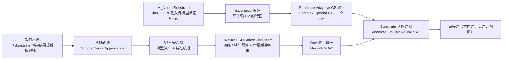

更新：2026-10-23（对应 M2）。本文回答：现在这套神经 BSDF 系统由哪些部分组成、数据怎样流动、和 UE 光照怎样衔接、有哪些限制。怎样一步步做到这里见 [项目历程](/projects/neural-bsdf-perf/history/)；性能见 [性能报告](/projects/neural-bsdf-perf/performance/)。


## 1. 概览



实现与资产在 `Engine/Plugins/Experimental/NeuralAppearanceLab`；一个独立的 UE 项目只作为编辑器宿主。引擎侧只有少量明确的接入点（第 6 节）。

## 2. 模块与目录

| 部分 | 位置 | 职责 |
|---|---|---|
| Runtime 模块 | 插件 `Source/NeuralAppearanceRuntime` | 模型资产、图集子系统、compute 验证路径、预览 Actor、灯光同步 Actor；不依赖 Python 或训练仓库 |
| Editor 模块 | 插件 `Source/NeuralAppearanceEditor` | 模型导入、原型场景生成、BRDF 捕获、着色基准、数值验证、控制台命令 |
| 共享 shader | `Engine/Shaders/Private/NeuralBSDF/`：`NeuralBSDFCommon.ush`（数据布局、通用求值）、`NeuralBSDFEvalImpl.ush`（模板化求值）、`NeuralBSDFSpecialized.ush`（光照用的特化核） | 所有消费者共用；插件 `Shaders/Public/NeuralBSDF.ush` 只转发 include |
| compute 验证 shader | 插件 `Shaders/Private/NeuralAppearanceInference.usf` | GlobalShader，按 UV 网格输出 BRDF，用于数值验证与预览 |
| 引擎接入 | Substrate shader、View 统一缓冲、场景渲染 | 见第 6 节 |
| Python / MCP | 插件 `Content/Python/neural_appearance_lab.py` | 编辑器 MCP 工具的薄入口，转发到 C++ |
| 离线脚本 | 插件 `Scripts/NeuralAppearance/` | 训练、导出、捕获对比、批量基准（`train_and_export.py`、`train_from_capture.py`、`compare_captures.py`、`run_shading_benchmarks.py`） |

## 3. 模型与资产

- **两种网络形状**：
  - latent MLP：10 → 32 → 32 → 3（输入 6 个方向分量 + 4 个潜特征），ReLU，Exp 输出；沿用 NVIDIA 神经外观的思路。
  - QTP（Quantized Triple Plane）：12 → 32 → 32 → 32 → 3，INT8 量化；输入是 H、U、D 三个平面各 4 通道的特征；沿用 Comprehensive Neural Materials 的三平面表示。
- **资产**：`UNeuralAppearanceModel`（权重、层描述、量化比例、特征平面引用），模型 schema 2。导入器把层描述和权重打包成一张 64 宽的 R32F 网络纹理（`T_Net_*`），无须为每组权重重新编译 shader。特征平面为 32×32 的线性 RGBA8 纹理。
- **来源**：
  - 解析教师训练的模型 `NA_Latent`、`NA_QTP`（`train_and_export.py` → `ImportModels`）。
  - 引擎内捕获训练的模型，例如 `OPBR_Latent`（`train_from_capture.py` → `ImportCapturedModel`，见 [捕获与对比](/projects/neural-bsdf-perf/capture-and-comparison/)）。
- **槽位**：Project Settings › Plugins › Neural BSDF 中的模型列表决定槽位编号（最多 16 个）；材质用槽位编号选择模型。

## 4. BSDF 契约

```hlsl
// 输入：UV、材质局部坐标系中的 Wi、Wo（都从表面指向外，z 为法线）
// 输出：BRDF f(Wi, Wo)，不含余弦、不含光源强度；背面方向输出 0
float3 NeuralBSDF_EvalLighting(uint Model, Texture2D Networks, Texture2D Features, float2 UV, float3 Wi, float3 Wo);
```

光源亮度、颜色、阴影、余弦都由渲染器负责，网络只给出材质的方向响应。依据是反射方程：

```text
L_o(x,\omega_o)=\int_{\Omega^+} f_\theta(x,\omega_i,\omega_o)\,L_i(x,\omega_i)\,\max(n\cdot\omega_i,0)\,d\omega_i
```

材质在不同方向上反射不同，所以网络需要 `ωi` 和 `ωo`；在线性光传输下，入射光强度翻倍时反射贡献也翻倍，所以亮度可以在网络求值之后相乘（见 [PBRT 的光传输方程](https://pbr-book.org/4ed/Light_Transport_I_Surface_Reflection/The_Light_Transport_Equation)）。由此：

- **多盏灯**：每盏灯各自得到 `ωi`，各查询一次网络，再分别乘入射光并相加；不能先平均方向再查询。
- **换灯光颜色、亮度或环境图**：不需要重新训练。
- **不能重复计算**：`Li` 已含可见性时不要再乘阴影；其他导出器可能返回 `f·cos` 或预积分结果，接入前必须核对契约。

| 数据 | 是否输入网络 | 由谁提供 |
|---|---|---|
| UV / 潜特征 | 是 | 几何与材质资产 |
| 入射方向 `ωi`、出射方向 `ωo` | 是（latent 直接输入；QTP 通过半角与差角坐标查询 H、D 平面间接输入） | 光源采样、相机方向 |
| 法线与切线框架 | 否，用于把世界方向转换到局部坐标 | 几何；各向异性材质依赖稳定的切线约定 |
| 光源颜色、强度、位置、阴影 | 否 | 渲染器 |
| GI / Lumen 的入射光 | 否 | 光照系统；目前神经求值只接直接光 |
| footprint / LOD | 否（尚未实现） | — |

`Sample` / `Pdf` 尚未实现。光照算法对材质的其他要求见 [全景与研究路线](/projects/neural-bsdf-perf/research/) 第 2 节。

## 5. 运行时数据：图集与常量缓冲

`UNeuralBSDFAtlasSubsystem` 在引擎启动后、`ImportModels` 之后或 `NeuralAppearanceLab.RebuildBSDFAtlas` 时打包所有槽位的模型：

| 数据 | 内容 | 使用者 |
|---|---|---|
| `View.NeuralBSDFNetworks` | 网络图集，每个模型 64×64 R32F | 通用求值器 |
| `View.NeuralBSDFFeatures` | 特征图集，每个模型 3P×P（所有平面必须同尺寸，当前 P = 32） | 所有求值器 |
| `View.NeuralBSDFConstants[2048]` | 32 KB 常量缓冲，按网络纹理相同的布局存放所有模型的头部和权重，每个模型 4 float 对齐 | 特化核 |
| `View.NeuralBSDFModelBase` | 每个模型在常量缓冲中的起点 | 特化核 |
| 打包权重区 | 追加在每个特化模型之后：latent 为 FP16x2 行（偏移写入头部 43 号槽位），QTP 为 INT8x4 行（42 号槽位） | 打包核 |

`r.NeuralBSDF.PackedWeights`（默认 1）：0 时不写打包区，用于 A/B 对比；改变时自动重建图集。

## 6. Substrate 延迟光照接入

前提：`r.Substrate.ProjectGBufferFormat=1`（Adaptive GBuffer，需要 SM6）与 `r.Substrate.NeuralBSDF=1`（项目设置，只读，改动后重编 shader）。不再需要 glint（M2 起）。Blendable GBuffer 下延迟光照不执行 Substrate BSDF 求值，也没有空间存放数据。

数据通路：材质 `M_NeuralSubstrate` 是一个 Slab，`GlintValue = -(slot + 1)` 作为神经标记，`GlintUV` 传 UV（只是作者接口，存储与 glint 无关）→ 创建 Slab 时 `NeuralBSDF_EncodePixel` 读模型头部、采样只依赖 UV 的特征 → `SubstrateExport` 写 3 个 uint（模型与类型、两个特征字）→ Adaptive GBuffer 的 Complex Special tile → 延迟光照中 `NeuralBSDF_UnpackPixel` 解包，`SubstrateEvaluateNeuralBSDF` 求值，结果为 `f(L, V) · 阴影 · NoL · 衰减`；面光源取代表性漫反射方向。

| 模型类型 | GBuffer 中的特征 |
|---|---|
| latent 10→32→32→3 | 潜向量，4 个 fp16 |
| QTP 12→32→32→32→3 | U 平面特征，已量化为第 0 层的 INT8（光照阶段得到相同的整数） |
| 其他形状 | UV（2 个 fp32），交给通用求值器 |

| 引擎改动 | 位置 |
|---|---|
| 共享求值实现与特化核 | `Engine/Shaders/Private/NeuralBSDF/` |
| `r.Substrate.NeuralBSDF`、`Substrate::IsNeuralBSDFEnabled`、shader 定义 `PLATFORM_ENABLES_SUBSTRATE_NEURAL_BSDF` 与 DDC 键 | `RenderUtils.h/.cpp`、`ShaderCompiler.cpp`、`Shader.cpp` |
| 带 Glint 输入的 Slab 在神经 BSDF 启用时也归入 Complex Special | `SubstrateTranslatorCommon.cpp` |
| 独立的 `BSDF_BIT_HASNEURAL`；`SUBSTRATE_NEURAL_BSDF_ENABLED = 复杂特殊路径 && 平台启用`；编码、打包、解包；参数混合时清除神经标志 | `Substrate/Substrate.ush`、`SubstrateExport.ush` |
| Slab 分支开头调用 `SubstrateEvaluateNeuralBSDF`；光照模式 `NEURAL_BSDF_LIGHTING_MODE`（0 内联、1 跳过、2 只算神经） | `Substrate/SubstrateEvaluation.ush` |
| 延迟光照排列维度 `FNeuralBSDFLightingMode`；`r.NeuralBSDF.SeparateLightingPass`（默认 0，拆分实测更慢，见 [M2 报告](/projects/neural-bsdf-perf/milestones/m2-storage-decoupling/)） | `LightRendering.cpp` |
| View 统一缓冲的 `NeuralBSDF*` 成员（第 5 节），全局 `GNeuralBSDFViewTextures` | `SceneView.h`、`SceneView.cpp`、`SceneManagement.cpp`、`SceneRendering.cpp` |
| SceneCapture 中 Complex Special tile 列表被截断的修复（只有捕获视图的场景） | `Substrate.cpp`，见 [捕获与对比](/projects/neural-bsdf-perf/capture-and-comparison/) |

修改 View 统一缓冲、`Substrate.ush` 或 `NeuralBSDFCommon.ush` 会使全部 shader 重编（首次约 1 小时，之后由 DDC 缓存）。

## 7. 求值器分派

`NeuralBSDF_EvalPixel` 按像素数据中的模型类型和模型头部中的打包区选择核：

| 模型形状 | 打包区存在 | 打包区不存在 |
|---|---|---|
| latent 10→32→32→3 | `NeuralBSDF_EvalLatentFp16`：FP16x2 权重、fp32 累加；第二隐藏层与输出层融合 | `NeuralBSDF_EvalLatent10x32x32`：fp32 完全展开 |
| QTP 12→32→32→32→3 | SM6：`NeuralBSDF_EvalQTPDp4a`：`dot4add_i8packed`，激活产生即量化打包，最后一层融合；与 fp32 核逐字节一致 | `NeuralBSDF_EvalQTP12x32x32x32`：fp32 完全展开，每层只量化一次输入 |
| 其他形状 | 通用求值器 `NeuralBSDF_EvalAtlas`（读网络图集） | 同左 |

所有分支都编译进同一个光照 shader，靠运行时分支选择。Complex Special 光照排列每线程 168（点光）/ 214（方向光）个寄存器，其中约 162 个是 Substrate 复杂特殊路径本身的需求，不是神经核单独造成的，详见 [M2 报告](/projects/neural-bsdf-perf/milestones/m2-storage-decoupling/) 第 4 节。

## 8. 其他执行路径

| 路径 | 用途 | 入口 |
|---|---|---|
| compute 验证 | 按 UV 网格输出 BRDF，与 Python 预测逐项比较 | `UNeuralAppearanceInference::EvaluateGrid`（GlobalShader `NeuralAppearanceInference.usf`，8×8 线程组）；`NeuralAppearanceLab.ValidateNative` |
| 预览 Actor | 固定方向下展示 UV 响应，不接 UE 灯光 | `ANeuralAppearancePreviewActor` + `M_NativePreview` |
| Unlit 灯光原型 | 用 MPC 同步一盏方向光，在 Unlit 材质中计算 `f·L·cosθ` 加环境近似；不接收阴影 | `NeuralAppearanceLab.BuildLitPrototype` → `L_NeuralLitPrototype` |
| 材质 Custom 节点 | 最早的原型，网络以 HLSL 写进材质 | 见 [项目历程](/projects/neural-bsdf-perf/history/) |

## 9. 编译、命令与工具

编译（先关闭编辑器）：

```powershell
& Engine/Build/BatchFiles/Build.bat DemoEditor Win64 Development -Project=<项目目录>/<项目>.uproject -WaitMutex -NoHotReloadFromIDE
```

编辑器启动加 `-noxgeshadercompile`（XGE shader 控制器会让任务永远不返回）。

| 控制台命令 / 变量 | 作用 |
|---|---|
| `NeuralAppearanceLab.ImportModels` | 导入解析教师训练的模型并重建图集 |
| `NeuralAppearanceLab.ValidateNative` | compute 路径的数值验证 |
| `NeuralAppearanceLab.BuildLitPrototype` | 生成 Unlit 灯光原型场景 |
| `NeuralAppearanceLab.BuildSubstratePrototype` | 生成 `M_NeuralSubstrate`、`MI_NeuralSubstrate_*` 与 `L_NeuralSubstrate` |
| `NeuralAppearanceLab.RebuildBSDFAtlas` | 重新打包图集 |
| `r.NeuralBSDF.PackedWeights` | 打包权重开关 |
| `r.Substrate.NeuralBSDF` | 项目设置（只读）：启用神经 BSDF 的标志与存储（M2） |
| `r.NeuralBSDF.SeparateLightingPass` | 神经 BSDF 单独一次光照绘制（默认 0，实测更慢，M2） |
| `r.NeuralBSDF.Real16` | 只读：Complex Special 光照着色器使用实时 16 位类型；2 为打包 fp16 的 latent 核（默认 0，M5） |

编辑器 MCP 工具（`neural_appearance_lab.NeuralAppearanceLabTools`）：`import_native_models`、`validate_native_inference`、`build_lit_prototype`、`build_substrate_prototype`、`build_openpbr_teacher`、`capture_material_brdf`、`benchmark_material_shading`、`import_captured_model`、`create_neural_substrate_instance`、`build_paired_comparison`、`build_comparison_scene`、`validate_gpu_inference`（旧 Custom 节点路径）、`set_lab_light`、`get_lab_status`。

## 10. 验证

compute 路径与 Python 的一致性（RTX 4060，每个模型 1024 组固定输入）：

| 模型 | 平均绝对差 | 最大绝对差 |
|---|---:|---:|
| latent MLP | 2.25e-8 | 4.17e-7 |
| QTP | 2.84e-6 | 3.61e-3 |

容差：latent `1e-5 / 1e-4`，QTP `1e-4 / 0.02`；QTP 仍有少量浮点与量化阈值相关的残差，未做到逐位一致。报告在插件 `Saved/native_gpu_validation.json`。

光照路径的外观质量由同路径捕获对比衡量（OpenPBR 教师，相对 L1 11.8%），见 [捕获与对比](/projects/neural-bsdf-perf/capture-and-comparison/)；各优化轮次的逐字节一致性检查见 [性能报告](/projects/neural-bsdf-perf/performance/)。

## 11. 当前限制

| 限制 | 影响 | 计划 |
|---|---|---|
| 只接直接光；Lumen GI、反射、天光、路径追踪使用 Slab 参数作代理 | M4 起代理逐 texel 拟合到网络（`ProxyFromTextures`），太阳 + 天光下对教师误差 10.5%；单波瓣代理表达不了清漆的锐利反射 | 双波瓣代理（[M4 报告](/projects/neural-bsdf-perf/milestones/m4-indirect-proxy/) 第 5 节） |
| 依赖 Adaptive GBuffer；作者接口仍是 Slab 的 Glint 输入 | 回退到 Blendable 时只剩代理 Slab；专用材质节点需要改材质图编译器 | — |
| 神经核与 Complex Special 光照在同一个 shader 里，168–214 寄存器 / 线程 | 占用率低；拆成独立绘制实测更慢（[M2 报告](/projects/neural-bsdf-perf/milestones/m2-storage-decoupling/)） | 降低神经核寄存器（M5） |
| 特征平面统一 32×32 | 只能表达低频空间变化 | 网络头部记录每模型平面尺寸（触发全局重编） |
| 副切线由 `cross(N, X)` 重建 | 可能与网格副切线符号不同，影响 latent 的方位角输入，未验证 | — |
| 没有 `Sample` / `Pdf`、没有过滤和 LOD | 不能用于路径追踪；远处可能闪烁 | 见全景与研究路线第 3 节 |
| 只有 latent 能从捕获训练，也只有 latent 有拟合代理 | QTP 只能用解析教师，代理为常数 | — |
| MegaLights、Substrate stochastic lighting 未验证；独立打包与 cook 未验证 | — | — |
