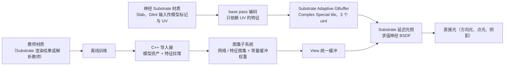

更新：2026-11-01（对应 M2）。本文回答：这套神经 BSDF 系统由哪些部分组成、数据怎样流动、和 UE 光照怎样衔接、有哪些限制。目录、命令、控制台变量这类细节不在这里展开，读代码时再查；性能见 [性能报告](/projects/neural-bsdf-perf/performance/)，计划见 [路线图](/projects/neural-bsdf-perf/roadmap/)。

## 1. 概览



实现与资产在引擎的实验性插件 `NeuralAppearanceLab`，一个独立的 UE 项目只作为编辑器宿主。运行时模块只管模型资产、图集和求值；训练与捕获对比在离线脚本和编辑器模块里；引擎侧只有少量明确的接入点（第 5 节）。

## 2. 模型与资产

- **两种网络形状**：
  - latent MLP：10 → 32 → 32 → 3（6 个方向分量 + 4 个潜特征），ReLU，Exp 输出；沿用 NVIDIA 神经外观的思路。
  - QTP（Quantized Triple Plane）：12 → 32 → 32 → 32 → 3，INT8 量化；输入是 H、U、D 三个平面各 4 通道的特征；沿用 Comprehensive Neural Materials 的三平面表示。
- **资产**：模型资产保存权重、层描述、量化比例和特征平面引用。导入器把层描述和权重打包成一张 R32F 网络纹理，换权重不需要重新编译 shader；特征平面是 32×32 的线性 RGBA8 纹理。
- **来源**：解析教师训练的模型，或引擎内捕获训练的模型（见 [捕获与对比](/projects/neural-bsdf-perf/capture-and-comparison/)）。
- **槽位**：项目设置里的模型列表决定槽位编号（最多 16 个），材质用槽位编号选择模型。

## 3. BSDF 契约

```hlsl
// 输入：UV、材质局部坐标系中的 Wi、Wo（都从表面指向外，z 为法线）
// 输出：BRDF f(Wi, Wo)，不含余弦、不含光源强度；背面方向输出 0
float3 NeuralBSDF_EvalLighting(uint Model, Texture2D Networks, Texture2D Features, float2 UV, float3 Wi, float3 Wo);
```

光源亮度、颜色、阴影、余弦都由渲染器负责，网络只给出材质的方向响应。依据是反射方程：在线性光传输下，入射光强度翻倍时反射贡献也翻倍，所以亮度可以在网络求值之后相乘（见 [PBRT 的光传输方程](https://pbr-book.org/4ed/Light_Transport_I_Surface_Reflection/The_Light_Transport_Equation)）。由此：

- **多盏灯**：每盏灯各得到一个入射方向，各查询一次网络，再分别乘入射光并相加；不能先平均方向再查询。
- **换灯光颜色、亮度或环境图**：不需要重新训练。
- **不能重复计算**：入射光已含可见性时不要再乘阴影；其他导出器可能返回带余弦或预积分的结果，接入前必须核对契约。

网络的输入只有 UV / 潜特征和入射、出射方向；法线与切线框架只用于把世界方向转到局部坐标；光源、阴影、GI 的入射光都由渲染器提供。目前没有 `Sample` / `Pdf`，也没有 footprint / LOD。

## 4. 运行时数据

图集子系统在引擎启动后或重新导入模型时，把所有槽位的模型打包进 View 统一缓冲：

- **网络图集**：每个模型一块 64×64 的 R32F，给通用求值器用。
- **特征图集**：每个模型 3P×P（所有平面必须同尺寸，当前 P = 32）。
- **常量缓冲**：32 KB，按网络纹理相同的布局存放所有模型的头部和权重，给特化核用，在同一 wave 内是标量读取。
- **打包权重**：追加在每个特化模型之后，latent 为 FP16x2，QTP 为 INT8x4，给打包核用；可用开关关掉做 A/B 对比。

## 5. Substrate 延迟光照接入

前提：Adaptive GBuffer（需要 SM6）与项目设置里的神经 BSDF 开关。M2 起不再需要 glint；Blendable GBuffer 下延迟光照不执行 Substrate BSDF 求值，也没有空间存放数据。

数据通路：神经材质是一个 Slab，用 Glint 输入传模型标记与 UV（只是作者接口，存储与 glint 无关）→ base pass 读模型头部、采样只依赖 UV 的特征 → 写入 3 个 uint（模型与类型、两个特征字）→ Adaptive GBuffer 的 Complex Special tile → 延迟光照中解包并求值，结果为 `f(L, V) · 阴影 · NoL · 衰减`；面光源取代表性漫反射方向。

| 模型类型 | GBuffer 中的特征 |
|---|---|
| latent 10→32→32→3 | 潜向量，4 个 fp16 |
| QTP 12→32→32→32→3 | U 平面特征，已量化为第 0 层的 INT8 |
| 其他形状 | UV（2 个 fp32），交给通用求值器 |

引擎改动集中在四处：Substrate 的 shader 与编译器（独立的神经标志位、编码与解包、Slab 分支里调用求值）、延迟光照的排列维度、View 统一缓冲的 `NeuralBSDF*` 成员，以及 SceneCapture 里 Complex Special tile 列表被截断的修复。修改这些共享文件会触发全部 shader 重编（首次约 1 小时，之后由缓存命中）。

## 6. 求值器

求值按模型形状和是否有打包权重分派：

- **latent**：有打包区时用 FP16x2 权重、fp32 累加，第二隐藏层与输出层融合；否则 fp32 完全展开。
- **QTP**：有打包区且 SM6 时用 `dot4add_i8packed`（dp4a），激活产生即量化，最后一层融合，与 fp32 核逐字节一致；否则 fp32 完全展开。
- **其他形状**：通用求值器读网络图集。

所有分支都编译进同一个光照 shader，靠运行时分支选择。Complex Special 光照排列每线程用 168（点光）/ 214（方向光）个寄存器，其中约 162 个是 Substrate 复杂特殊路径本身的需求，不是神经核单独造成的，详见 [M2 报告](/projects/neural-bsdf-perf/milestones/m2-storage-decoupling/)。

## 7. 验证

compute 验证路径与 Python 预测对比：latent 平均绝对差 2.25e-8，QTP 2.84e-6（最大 3.6e-3，与浮点和量化阈值有关，未做到逐位一致）。光照路径的外观质量由同路径捕获对比衡量（OpenPBR 教师，相对 L1 11.8%），见 [捕获与对比](/projects/neural-bsdf-perf/capture-and-comparison/)；各优化轮次的逐字节一致性检查见 [性能报告](/projects/neural-bsdf-perf/performance/)。

## 8. 当前限制

| 限制 | 影响 | 计划 |
|---|---|---|
| 只接直接光；Lumen GI、反射、天光使用 Slab 参数作代理 | M4 起代理逐 texel 拟合到网络，太阳 + 天光下对教师误差 10.5%；单波瓣代理表达不了清漆的锐利反射 | 双波瓣代理（[M4 报告](/projects/neural-bsdf-perf/milestones/m4-indirect-proxy/)） |
| 依赖 Adaptive GBuffer；作者接口仍是 Slab 的 Glint 输入 | 回退到 Blendable 时只剩代理 Slab | — |
| 神经核与 Complex Special 光照在同一个 shader 里，168–214 寄存器 / 线程 | 占用率低；拆成独立绘制实测更慢 | 降低神经核寄存器（M5） |
| 特征平面统一 32×32 | 只能表达低频空间变化 | 每模型记录平面尺寸 |
| 没有 `Sample` / `Pdf`、没有过滤和 LOD | 不能用于路径追踪；远处可能闪烁 | 见 [全景与研究路线](/projects/neural-bsdf-perf/research/) |
| 只有 latent 能从捕获训练，也只有 latent 有拟合代理 | QTP 只能用解析教师，代理为常数 | — |
| 副切线重建方式、MegaLights、Substrate stochastic lighting、打包与 cook 尚未验证 | — | — |
