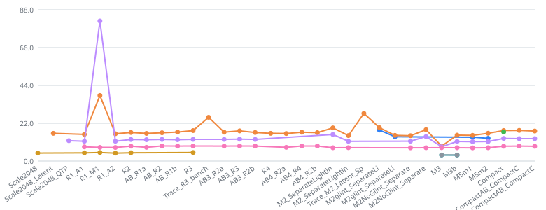

神经材质接入 UE 后，用一套固定环境的基准和回归检查来比较不同实现的 GPU 开销。本页是这套体系的总结；各轮结果与瓶颈分析见[性能报告](/projects/neural-bsdf-perf/performance/)，录制与读 Trace 的方法见 [GPU Trace 手册](/projects/neural-bsdf-perf/gpu-trace-guide/)。

## 问题
神经材质(Neural BSDF)接入 Unreal Engine 后,需要持续比较不同实现(Latent、QTP、Latent128、Slab 近似等)的 GPU 开销。靠手工记录单次结果,难以复现,也容易被环境波动误导。

## 做了什么

- **采集**:固定渲染环境(全屏四边形、1 盏平行光加 2 盏点光、无阴影与 GI),批量计时;同时用 nvidia-smi 采样 SM 时钟与 P-state,让降频的结果一眼可见。
- **归档**:汇总 190 份历史基准报告,按实验分组、合并重复运行,覆盖 33 个 2048px 实验与 4 套测量协议。
- **回归检查**:固定一次实验作为基线,容差默认 5%,超限时返回非零退出码,可直接接入 CI。

## 两个发现

1. **不同测量协议的结果不可直接比较。** 早期用 1024px 逐帧计时,同一材质约 109 ms;后期改为 2048px 批量计时后约 17 ms,差一个量级。所以比较键包含"分辨率与计时方式",只在同一协议内对比。
2. **会话之间存在漂移。** 对照材质 OpenPBR 没有任何改动,在不同实验中的耗时却在 7.67–8.80 ms 之间波动(约 15%),来源是 GPU 时钟、驱动与温度等。只比原始毫秒数会把这种波动误判成性能变化,因此回归检查改用**相对对照材质的耗时比值**。

## 验证

- 在真实数据上:`M5m2` 实验里神经材质的原始耗时看起来快了 8.9%,但对照材质同样快了 10.5%,折算成比值仅 +1.7%,判为正常。
- 人为把一组数据的神经材质耗时放大 15%,检查给出 +14.0% 并判定失败(退出码 1),其余材质不受影响。

## 趋势

图为同一协议下每次实验的耗时中位数(重复运行已合并)。其中 `R1_M1` 一处尖峰:NeuralLatent 约 38 ms、NeuralQTP 约 81 ms,而对照材质正常,说明是该配置本身让神经材质变慢,而非环境波动。

 TODO(补充): R1_M1 这次具体改了什么、怎么定位的 

## 局限

- 比值法假设各材质在 GPU 时钟变化时按相近比例缩放,是近似,不是严格成立。
- 目前依赖编辑器侧的 MCP 采集,仅在单机单卡上验证。

 TODO(补充): 脚本整理成公开仓库后,在「局限」下方放链接 
