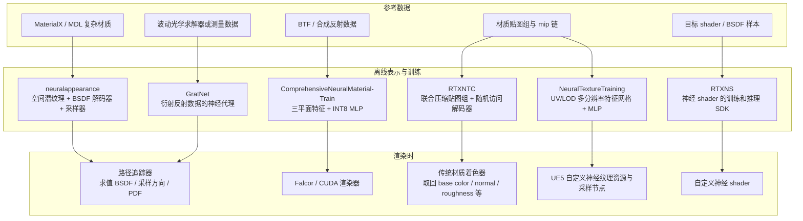
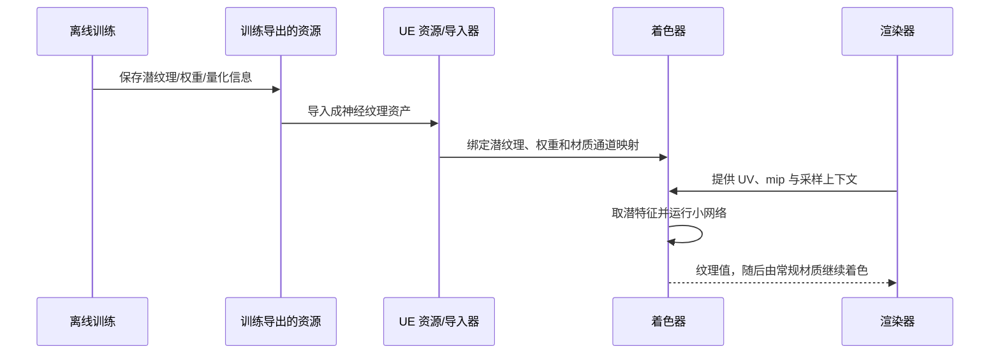

更新：2026-10-22。本文回答：本地研究目录中各研究仓库的代码怎么读：每个网络在拟合什么，表示怎样从训练器流到资源和着色器，入口文件在哪里。

## 1. 全局数据流

神经纹理类（RTXNTC、NeuralTextureTraining）的输出是纹理值，随后仍由常规材质着色；神经材质类（neuralappearance、Comprehensive）直接参与方向相关的散射求值，输出不能当作 RGB 纹理。

## 2. 各仓库

### 2.1 `neuralappearance`：潜纹理条件下的方向散射

README 描述为 MaterialX / MDL 参考材质的训练管线：在 GPU 上产生 BSDF 训练样本，学习潜纹理、小型 BSDF 解码器和重要性采样器。直接配套的论文是 2026 年 Taming Optimization Variance；2024 年 Real-Time Neural Appearance Models 提供基础表示与运行时方法。

运行时调用顺序见 `neural_material.slang` 第 45–46 行（这里只记录读法，不转载源码），分两步：第一步从潜纹理做双线性随机采样，用材质编号、mip 级别和击中点 UV 取潜特征；第二步把材质编号、mip、潜特征和局部入射 / 出射方向一起交给解码器做前向求值。

先按击中点 UV 和 mip 取空间潜特征，再把局部入射 / 出射方向与潜特征输入解码器。重要性采样路径在第 63–68 行另行读取潜纹理、解码采样参数，生成 `wo` 和 `pdf`。所以训练产物是可由路径追踪器调用的散射模型，不只是压缩贴图；只移植 `f` 而不移植兼容的采样器，噪声和质量会与论文不同。

入口：`neuralappearance\train.py`；默认样例材质 `assets/materials/FauxLeather.mtlx`；训练配置 `configs/default.json`，另有 `single_instance_training_large`、`single_instance_training_small`、`multi_instance_training_small` 三个对应 Taming 论文的实验配置。依赖 Falcor2、Slang / SlangPy、MaterialX、MDL 和支持 cooperative vector 的 GPU。

### 2.2 `ComprehensiveNeuralMaterial` 与 `-Train`：三平面 + INT8

对应 Towards Comprehensive Neural Materials（SIGGRAPH 2025），与 neuralappearance 是独立实现。

- 训练：`ComprehensiveNeuralMaterial-Train`，入口 `train_qtp.py`，导出 `export_weights.py`，需要 BTF 数据（不是 MaterialX / MDL）。README 中的 InstantNeuralMaterial 是旧仓库名。
- 渲染：`ComprehensiveNeuralMaterial`，Falcor 8.0 / CUDA，核心推理在 `Source/Falcor/Utils/Neural/cuda/Inference.cu`。
- 移植时先核对潜平面布局、权重格式与量化缩放、方向约定和采样约定，再研究合成与位移。

### 2.3 `RTXNTC`：随机读取压缩后的材质贴图

把多通道材质数据及 mip 链编码成潜纹理与权重，运行时按需解码 texel；空间查询基于 UV / mip，解出的值映射回 base color、opacity、normal、roughness 等常规通道。

`samples\renderer\NtcForwardShadingPass.hlsl` 的顺序：先选择随机过滤所需的 texel / mip（第 60–63 行），再调用 `NtcSampleTextureSet...`（第 70–78 行）解码通道，最后填入传统 `MaterialTextureSample`（第 86 行起）。`USE_COOPVEC` 路径调用 `NtcSampleTextureSet_CoopVec_FP8`。可见 RTXNTC 改的是纹理表示和读取，不替代 BRDF、灯光积分或 UE 材质系统。

入口：`include\`、`samples\renderer\NtcForwardShadingPass.hlsl`、`samples\renderer\NtcMaterialLoader.cpp`、`docs\integration\`。另有 `support/tools/ue5_ntc_offline_prototype.py`，但不是可直接挂入本地 UE 5.8 的插件。

### 2.4 `NeuralTextureTraining` 与 `UnrealEngine-NeuralTexture`：UV 特征网格 + MLP

第三方训练项目把每张输入纹理按 UV 和 LOD 学成多分辨率 hash grid / feature grid，再由 MLP 预测通道值。`model.py` 第 75–88 行创建二维 hash-grid 编码，第 94–106 行创建全连接网络，`forward()`（第 144–179 行）读取 UV、LOD 并输出多个纹理通道。核心对象是纹理值，不是带方向输入的 BSDF。

`UnrealEngine-NeuralTexture` 含 UE 5.5 插件参考源码：

- `Engine/Plugins/NeuralTexturePlugin/Source/NeuralTexture/Private/NeuralTexture2D.cpp`
- `Engine/Plugins/NeuralTexturePlugin/Source/NeuralTexture/Private/NeuralTextureResource.cpp`
- `Engine/Plugins/NeuralTexturePlugin/Source/NeuralTexture/Private/MaterialExpressionNeuralTextureSample.cpp`
- `Engine/Plugins/NeuralTexturePlugin/Shaders/Public/NeuralTextureInference.ush`

训练器、导出格式、UE 导入器、资产资源和 shader 组成「训练 → 导出 → 导入 → 材质采样」链路：

这是稀疏检出的参考代码，不是本地 UE 5.8 的即用插件；训练仓库没有标出专属的同行评审论文，研究背景读 NTC 论文，但两者的模型结构和指标不能视为相同。

### 2.5 `RTXNS`：构建神经 shader 的 SDK

开发起点：网络训练、推理以及神经 shader / texture 示例，关注如何在 Slang 中表达并执行神经网络（包括 cooperative vector 等硬件路径）。它不是神经材质模型，也不能把 neuralappearance 的训练结果自动变成 UE 的 BSDF。教程见 `docs/SimpleTraining.md`、`docs/ShaderTraining.md` 与对应 samples；SDK demo 的指标不能与论文的资产和误差混为一谈。

## 3. 源码定位表

| 功能点 | 文件位置 |
|---|---|
| neuralappearance 训练入口 / 默认配置 | `neuralappearance\neuralappearance\train.py`；`neuralappearance\configs\default.json` |
| neuralappearance 运行时 `eval / sample / pdf` | `neuralappearance\neuralappearance\rendering\neural_material.slang` |
| Comprehensive 训练与导出 | `ComprehensiveNeuralMaterial-Train\train_qtp.py`；`export_weights.py` |
| Comprehensive CUDA 推理 | `ComprehensiveNeuralMaterial\Source\Falcor\Utils\Neural\cuda\Inference.cu` |
| RTXNTC 运行时采样与传统通道映射 | `RTXNTC\samples\renderer\NtcForwardShadingPass.hlsl` |
| RTXNTC 材质通道映射及加载 | `RTXNTC\samples\renderer\NtcChannelMapping.h`；`NtcMaterialLoader.cpp` |
| 第三方神经纹理的 hash grid + MLP 与 LOD | `NeuralTextureTraining\model.py` |
| 第三方 UE 插件的资源、工厂、采样节点与 shader | `UnrealEngine-NeuralTexture\Engine\Plugins\NeuralTexturePlugin\` |
| RTXNS 教程与 shader 推理示例 | `RTXNS\docs\ShaderTraining.md`；`samples\SimpleInferencing\` |

## 4. 本地状态

以 `README.txt` 为准：

- `neuralappearance`：Falcor2 顶层 `data` 子模块尚未初始化，训练管线没有在本机完整构建和运行。
- `ComprehensiveNeuralMaterial` 与 `-Train`：源码已收录，尚未构建运行。
- `UnrealEngine-NeuralTexture`：UE 5.5.1 参考分支的稀疏检出。
- `RTXNTC`、`RTXNS`：独立 SDK 源码。

本地有源代码不等于已经具备复现实验的依赖和数据。本项目在 UE 中的实现见 [系统架构](/projects/neural-bsdf-perf/architecture/) 与 [性能报告](/projects/neural-bsdf-perf/performance/)。
