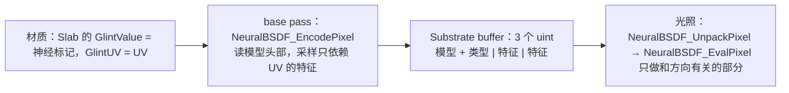

更新：2026-10-23。本文回答：路线图 M2（神经 BSDF 不再借用 glint、专用标志位与 GBuffer 数据、opt-in 的光照路径）做了什么、测到了什么、哪些假设被推翻、最后保留了什么。

## 1. 结论

| 项 | 结果 |
|---|---|
| 不再依赖 glint | 新的项目设置 `r.Substrate.NeuralBSDF` 和独立的 BSDF 标志位；`r.Substrate.Glints=0` 时神经材质照常工作（第 5 节） |
| GBuffer 存逐像素数据 | base pass 算好只依赖 UV 的部分，每像素 3 个 uint（原来借 glint 槽位是 4 个）；光照阶段不再按灯读特征纹理 |
| 性能 | 场景中逐灯光照（UnbatchedLights）1.153 → 1.025 ms（−11%）；2048² 全屏 latent 约 15.7 → 14.8–14.9 ms（OpenPBR 对照不变） |
| 数值 | QTP 与 R2 相对差 0.015%，latent 0.053%（fp16 存储），对 OpenPBR 教师误差仍为 11.8% |
| 神经光照拆成独立绘制（mode 1 / 2） | **更慢**：全屏 +30%，场景逐灯 +22%，连 glint 材质也慢 28%。保留为实验开关 `r.NeuralBSDF.SeparateLightingPass`，默认关闭 |
| 被推翻的假设 | “神经核把 Complex Special 光照 shader 推到 168 寄存器”：去掉神经核后该 shader 仍需约 162 个；单独的神经 shader 反而要 212–218 个（第 4 节） |

M2 的判断标准是“普通材质性能不受影响；关闭 glint 后神经材质照常工作”。第二条达成；第一条在默认的内联模式下与 M1 相同（Complex Special tile 中的非神经像素仍和神经核共用一个 shader），拆分没有带来改善，原因见第 4 节。

## 2. 做了什么

### 2.1 存储

| 模型类型 | 存什么 | 精度 |
|---|---|---|
| latent 10→32→32→3 | 潜向量（4 个 fp16） | 与 fp32 相比有舍入，见第 3 节 |
| QTP 12→32→32→32→3 | U 平面特征，已量化为第 0 层的 INT8（4 字节） | 精确：光照阶段得到相同的整数 |
| 其他形状 | UV（2 个 fp32），交给通用求值器 | 与原来一致 |

- **标志位**：`BSDF_BIT_HASNEURAL` 不再要求同时置 glint 位；`SUBSTRATE_NEURAL_BSDF_ENABLED = 复杂特殊路径 && PLATFORM_ENABLES_SUBSTRATE_NEURAL_BSDF`。
- **材质编译**：带 glint 输入的 Slab 在 glint 或神经 BSDF 启用时都归入 Complex Special；按 4 个 uint 预留空间（材质编译时不知道是 glint 还是神经标记）。
- **Slab 混合**：参数混合（layering、mix）后清掉神经标志，混合结果用 Slab 参数作代理。
- **作者接口不变**：仍通过 Slab 的 Glint 输入传标记和 UV。专门的材质节点需要改材质图编译器，留作后续。

### 2.2 光照模式

`NEURAL_BSDF_LIGHTING_MODE` 是 `FDeferredLightPS` 的新排列维度，只在 Complex Special tile、启用神经 BSDF、非头发、非裁剪可视化时编译：

| 模式 | 含义 | 使用 |
|---|---|---|
| 0 | 神经 BSDF 与其他 BSDF 在同一个 shader 中求值 | 默认（`r.NeuralBSDF.SeparateLightingPass=0`） |
| 1 | 跳过神经 BSDF | 拆分时的常规绘制 |
| 2 | 只求值神经 BSDF，其他 BSDF 类型的代码不编译 | 拆分时额外的一次绘制 `Light::StandardDeferred(NeuralBSDF)` |

拆分开启时，每盏灯在 Complex Special tile 上画两次（同一组 tile 和模板），结果相加。

## 3. 数值验证

同路径捕获（[捕获与对比](/projects/neural-bsdf-perf/capture-and-comparison/) 的方法，同种子）：

| 对比 | 相对 L1 | 中位 PSNR | 能量比 |
|---|---:|---:|---:|
| QTP：R2 → M2 | 0.015% | 58.5 dB | 1.0000 |
| latent：R2 → M2 | 0.053% | 76.0 dB | 0.9997 |
| latent M2 对 OpenPBR 教师 | 11.76% | 22.7 dB | 0.977 |

QTP 没有做到逐字节一致：原来光照阶段用的是 glint 槽位里 24 位打包的 UV，现在 base pass 直接用材质的完整精度 UV，少数像素的 U 特征量化结果因此不同。latent 的差异来自潜向量的 fp16 存储。对教师的误差没有变化。

## 4. 性能

测试平台与方法同 [性能方法手册](/projects/neural-bsdf-perf/gpu-trace-guide/)：RTX 4060 笔记本，2048² 全屏基准（1 方向光 + 2 点光，无阴影），A-B-A 交替，SM 时钟 2865–2880 MHz。

### 4.1 全屏基准

| 材质 | 拆分（1） | 内联（0） |
|---|---:|---:|
| OpenPBR（对照） | 7.72 ms | 7.78 ms |
| 神经 latent | 19.31 ms | 14.84 ms |
| 神经 QTP | 15.48 ms | 11.48 ms |
| glint 对照材质 | 18.06 ms | 14.14 ms |

每组 5 轮（拆分 3 次、内联 2 次）的中位数；同一设置的轮次间差异小于 0.6 ms。内联 latent 比 R2 的约 15.7 ms 快约 6%。

### 4.2 场景 GPU Trace

`L_NeuralCaptured_OPBR`（教师球与神经球并排，太阳 + 两盏点光，阴影，Lumen），固定相机，单帧：

| 范围 | R2（R4 时的 trace） | M2 内联 | M2 拆分 |
|---|---:|---:|---:|
| UnbatchedLights | 1.153 ms | 1.025 ms | 1.250 ms |
| 其中太阳 | 0.676 ms | 0.628 ms | 0.746 ms |

`VirtualShadowMapProjectionMaskBits` 在不同启动之间相差一倍（0.53–1.06 ms），与神经 BSDF 无关，所以比较只用 UnbatchedLights。

Complex Special tile 上的 `DeferredLightPixelMain`（按 PS 哈希对应，其他 tile 类型的管线在两次 trace 中完全相同）：

| shader | 点光（VertexMain） | 方向光（SubstrateTilePassVS） |
|---|---:|---:|
| 内联（mode 0） | 168 寄存器 | 214 寄存器 |
| 拆分：常规部分（mode 1，无神经核） | 163 寄存器 | 162 寄存器 |
| 拆分：神经部分（mode 2，只有神经核） | 218 寄存器 | 212 寄存器 |

### 4.3 为什么拆分更慢

1. **去掉神经核并没有让常规 shader 变轻**：mode 1 仍需 162–163 个寄存器，Substrate 复杂特殊路径（多 BSDF 循环、各向异性、glint、雾化等）本身就很重。M1 时把 168 寄存器归因于神经核，是把同一个 shader 里两部分的需求混在了一起。
2. **只含神经核的 shader 寄存器反而更多**：代码少了之后，编译器有余地把更多权重读取和中间结果提前排进寄存器以换取指令并行，结果是 212–218 个寄存器、更低的占用率。
3. **第二次绘制有固定成本**：每盏灯都要对同一批 tile 再做一遍 Substrate 解包、阴影项、光源参数和混合写回，在 2048² 全屏上约 1.3 ms/灯。
4. **glint 材质也变慢**：拆分时，神经绘制覆盖全部 Complex Special tile，glint 像素要走一遍完整的逐像素准备才发现自己不是神经 BSDF。

结论：在这块 GPU 上，按 tile 拆出一次额外的光照绘制不是降低神经光照成本的办法。要降成本，得减少神经核本身的寄存器（M5 的方向），或让神经求值不再按灯重复（例如把与光源无关的部分每像素只算一次）。

### 4.4 测量过程中的问题

- **GPU Trace 解析**：Nsight 2026.3 在较大的 trace 中把元数据和数据块拆成多个 LZ4 块，本地的 nsight-graphics-mcp 只读第一个块，导致“chunk 0 compressed size is outside the configured safety limit”。已在本地副本中按块循环解析（头部 16 字节处是块数，后续块各有 24 字节头：标签、压缩大小、未压缩大小）。
- **基准与 trace 的配合**：全屏基准每次 tick 提交 16 次捕获后要等读回，单帧 trace 很容易落在两批之间；场景 trace 更可靠。
- **拆分的第一次 trace** 出现了约 450 KB 的光照 shader，第二次没有：首次运行时新排列的 PSO 尚未预缓存，引擎回退到 uber shader。比较时用的是 PSO 就绪后的 trace。

## 5. 关闭 glint 的验证

Demo 工程设为 `r.Substrate.Glints=0`、`r.Substrate.NeuralBSDF=1`，重新编译 shader 后：

| 检查 | 结果 |
|---|---|
| 同种子捕获对比 glint 开启时的 M2 捕获 | latent、QTP 相对 L1 均为 0，PSNR > 100 dB：逐像素一致 |
| 全屏基准（内联，3 轮 A-B-A 中位数） | OpenPBR 7.72 ms，latent 14.74 ms，QTP 11.55 ms，与 glint 开启时相同 |
| 拆分（对照） | latent 18.26 ms，QTP 14.23 ms，仍慢约 25% |

神经 BSDF 不再需要 glint。之后 Demo 工程恢复 `r.Substrate.Glints=1`，因为 M3 的 Automotive 材质包含 glint 材质；两种设置的 shader 都已在 DDC 中。

## 6. 改动清单

| 位置 | 改动 |
|---|---|
| `RenderUtils.h/.cpp`、`ShaderCompiler.cpp`、`Shader.cpp` | `r.Substrate.NeuralBSDF`、`Substrate::IsNeuralBSDFEnabled`、shader 定义 `PLATFORM_ENABLES_SUBSTRATE_NEURAL_BSDF` 与 DDC 键 |
| `SubstrateTranslatorCommon.cpp` | 带 glint 输入的 Slab 在神经 BSDF 启用时也归入 Complex Special，并预留空间 |
| `Substrate.ush`、`SubstrateExport.ush` | 独立标志、编码 / 打包 / 解包、Slab 混合时清除 |
| `SubstrateEvaluation.ush` | 光照模式 0 / 1 / 2 |
| `NeuralBSDFSpecialized.ush` | `FNeuralBSDFPixel`、`NeuralBSDF_EncodePixel / PackPixel / UnpackPixel / EvalPixel`；各核改为接收逐像素特征 |
| `LightRendering.cpp` | 排列维度 `FNeuralBSDFLightingMode`、拆分绘制、`r.NeuralBSDF.SeparateLightingPass`（默认 0） |
| Demo `DefaultEngine.ini` | `r.Substrate.NeuralBSDF=1` |
| 插件 `run_ab.py`、编辑器工具 | A-B-A 基准脚本；`set_lab_cvar`、`create_glint_control` 等受限测量工具 |
