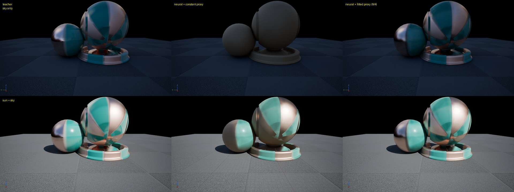

更新：2026-10-23。本文回答：路线图 M4（让 Lumen GI、Lumen 反射和天光看到的材质与神经直接光一致）怎么做、效果如何、还差什么。


## 1. 结论

| 项 | 结果 |
|---|---|
| 问题 | 神经 BSDF 只接管直接光；Lumen GI、Lumen 反射、天光、反射捕获都使用材质的 Slab 输入。原来的 Slab 是常数（反照率 0.3/0.2/0.12、F0 0.04、粗糙度 0.45），所以间接光照亮的是另一种材质 |
| 做法 | 离线把 Substrate Slab（DiffuseAlbedo、F0、F90、Roughness）逐 texel 拟合到训练好的网络，存成两张 64×64 纹理；材质用参数 `ProxyFromTextures` 切换 |
| 只有天光（神经材质完全靠代理） | 对教师的相对误差 66.6% → **18.6%**；亮度从教师的 0.44 倍到 0.86 倍 |
| 太阳 + 天光（完整画面） | 22.2% → **10.5%**，亮度 0.85 倍 → 0.96 倍；已接近网络本身直接光误差（11.8%） |
| 判断标准“开启 Lumen 时金属与清漆外观基本一致” | 达成：铜色金属的反射、青色漆面和亮度都与教师一致（第 4 节图）；剩余差异主要是清漆的锐利反射 |
| 运行时成本 | 每像素多两次纹理采样，只在材质求值时（base pass、Lumen 卡片捕获）发生；光照阶段不变 |

## 2. 为什么需要代理

[系统架构](/projects/neural-bsdf-perf/architecture/) 第 4 节的契约里，网络只回答“某个入射方向的光以多大比例射向某个出射方向”。直接光每盏灯一个方向，逐灯调用网络即可。间接光是对整个半球积分：

```text
L_{\text{indirect}}(\omega_o)=\int_{\Omega^+} f(\omega_i,\omega_o)\,L_{\text{env}}(\omega_i)\,\cos\theta_i\,d\omega_i
```

Lumen 和反射捕获不会对每个像素再积分一遍任意 BSDF，而是把材质看成“漫反射反照率 + GGX 高光（F0、F90、粗糙度）”，用预积分（环境 BRDF 查表、按粗糙度选反射 mip）近似这个积分。所以要让间接光正确，最直接的办法是给它一个在积分意义上接近网络的 Slab。

## 3. 拟合

脚本：插件 `Scripts/NeuralAppearance/fit_proxy.py`。

| 项 | 设置 |
|---|---|
| 目标 | 训练好的 latent MLP（从 `manifest.json` 与潜平面 PNG 重建，与 UE 中的权重一致） |
| 代理模型 | `f = DiffuseAlbedo / π + GGX(F0, F90, Roughness)`，Schlick Fresnel 从 F0 到 F90，Smith 遮蔽，和训练端的解析 GGX 相同 |
| 采样 | 64×64 个 texel 中心；256 对方向，一半半球均匀，一半在镜面方向附近（高光波瓣所在） |
| 损失 | `log1p(f·cosθi)` 的 L1，与网络训练时相同的空间，避免掠射角被放大 |
| 优化 | 每个 texel 8 个参数（sigmoid 约束到 [0,1]），Adam；粗糙度从 0.25 / 0.5 / 0.8 三个起点各优化一次，逐 texel 取最好的；CPU 132 秒 |
| 输出 | `ProxyBase`：sRGB DiffuseAlbedo + 线性 Roughness（A）；`ProxySpec`：sRGB F0 + 线性 F90（A）；`proxy.json` 记录指标。指标用量化到 8 位后的值计算，与 UE 读到的一致 |

一开始没有拟合 F90（固定为 1），掠射角的方向反照率误差仍有 36%：这个网络在掠射角变暗，而 F90 = 1 的 Fresnel 会在掠射角变亮。加入 F90 后（平均拟合值 0.2）降到 13%。

方向反照率（对 wi 积分的 `f·cos`，即一个方向看过去材质反射了多少入射光，Lumen 和反射最依赖的量）相对网络的误差：

| 观察角 | 常数代理 | 拟合代理 |
|---|---:|---:|
| 接近法线（cos 0.9） | 61% | 5.4% |
| 中等（cos 0.5） | 59% | 13.0% |
| 掠射（cos 0.2） | 43% | 13.5% |
| 全部方向对上的 log 误差 | 0.145 | 0.028 |

拟合出的平均参数：DiffuseAlbedo (0.06, 0.13, 0.11)，F0 (0.43, 0.29, 0.24)，F90 0.20，粗糙度 0.37。也就是说，网络学到的是“偏金属的高光 + 很暗的漫反射”，与教师（铜色金属与带清漆的青色漆面）一致，而原来的常数代理是一种暗橙色的非金属。

## 4. 场景验证

场景 `/NeuralAppearanceLab/Maps/L_NeuralProxyCheck`（编辑器工具 `build_proxy_check_scene`）：灰色地面、球和材质预览模型、方向光 `Proxy_Sun`、使用 `Desert_Outer_HDR` 立方体贴图的天光（与太阳无关，关掉太阳时环境不变）、Lumen GI 与反射、手动曝光。脚本 `run_lit_compare.py` 用同一相机依次换上三种材质截图（每次等 8 秒让着色器和 Lumen 收敛），在物体覆盖的像素上与教师比较（线性亮度）。

| 光照 | 常数代理 | 拟合代理 |
|---|---|---|
| 只有天光 | 相对 L1 66.6%，亮度 0.44 倍 | 18.6%，0.86 倍 |
| 太阳 + 天光 | 22.2%，0.85 倍 | 10.5%，0.96 倍 |



“只有天光”这一行最能说明问题：此时神经材质完全没有直接光，画面全部来自代理。常数代理是一块暗灰色的漫反射体；拟合代理恢复了铜色金属的反射、青色漆面和条纹布局。

最初在没有天空的 `L_NeuralCaptured_OPBR` 中做的同样比较看不出差别（常数 7.4%、拟合 8.5%）：那个场景只有太阳和两盏点光，间接光只来自地面的一次反弹，误差几乎全是网络本身的直接光误差和时间噪声。验证间接光需要一个间接光占主导的场景。

## 5. 限制

| 限制 | 影响 | 可能的改进 |
|---|---|---|
| 单个 GGX 波瓣 | 清漆（粗糙度 0.12）叠在较粗糙的底层上，代理只能取一个折中的粗糙度（平均 0.37）：反射中的锐利高光弱于教师 | 拟合 Substrate 的双波瓣（Haziness）或两层 Slab |
| 拟合目标是网络 | 代理继承网络的误差；也可以直接拟合教师捕获 | 两者可对比 |
| 只在 latent 模型上实现 | QTP 需要按其三平面结构查询网络 | 同样的脚本，换前向函数 |
| 64×64 代理纹理 | 与潜平面（32×32）同量级的空间分辨率 | 真实材质需要更高分辨率，见 M3 |
| 代理不是网络的严格积分 | 拟合在逐方向上进行，不保证方向反照率逐角度相等 | 在损失中加入方向反照率项 |

## 6. 改动清单

| 位置 | 改动 |
|---|---|
| 插件 `Scripts/NeuralAppearance/fit_proxy.py` | 新增：逐 texel 拟合 |
| `NeuralAppearanceEditorLibrary.cpp` | `ImportCapturedModel` 发现 `proxy.json` 时导入两张代理纹理（sRGB、BC7、有 mip） |
| `NeuralAppearanceLitPrototype.cpp` | `M_NeuralSubstrate` 增加 `ProxyBase`、`ProxySpec`、`ProxyFromTextures`，Slab 的 DiffuseAlbedo / Roughness / F0 / F90 在常数与纹理间切换；`CreateNeuralSubstrateInstance` 自动重建旧材质并设置代理纹理 |
| 编辑器工具 | `create_constant_proxy_variant`、`build_proxy_check_scene`、`set_light_intensity`、`set_actor_material`、`set_viewport_camera`、`take_screenshot` |
| 插件 `Scripts/NeuralAppearance/run_lit_compare.py` | 新增：场景对比 |
| 资产 | `T_OPBR_Latent_ProxyBase / ProxySpec`、`MI_NeuralSubstrate_OPBR_Latent`（拟合代理）、`MI_NeuralSubstrate_OPBR_Latent_ConstProxy`、`L_NeuralProxyCheck` |
