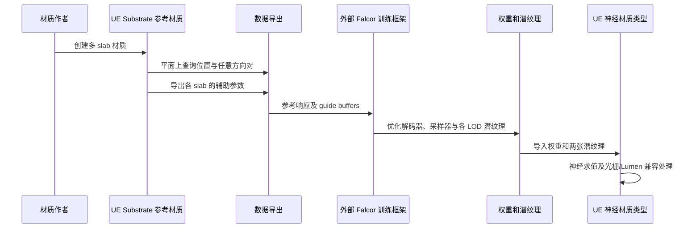

对应 PDF：`Bridging_Offline_Real_Time_Neural_Materials_SIGGRAPH2025_course_notes.pdf`，共 11 页。本文页码均指 PDF 物理页，从 1 开始。更新：2026-10-18。

本文基于该本地 PDF；“原文方法”与“UE 接入推断”分开说明。图是帮助理解的流程示意，不是论文原图。

## 这份资料对当前工程最直接的价值

作者 Andrea Weidlich 在第 4 节描述了已经做过的 UE 集成：用 Substrate 创作参考材质，在外部训练，然后将神经材质放回 UE 的光栅化管线，使用 Lumen。它证明的是作者的实现路线可行，不等于当前下载的 neuralappearance 已包含该 UE 插件。

## PDF 1–4 页：为什么要烘焙整个响应

讲义先比较影视材质和游戏材质。问题并非只缺纹理分辨率：多个散射层、各向异性、不同法线和混合/涂层操作本身也决定外观。只把复杂图转成几张传统 PBR 贴图，会受到目标材质模型表达能力的限制。

第 3 节介绍潜纹理和解码器，求值与采样分阶段训练。2×16、2×32、3×64 是解码器容量选择，不是材质层数。较小网络更快，但掠射角色彩与窄高光可能丢失；应同时看图像差异和耗时。

## PDF 4–6 页：Substrate 参考数据如何生成

作者关闭性能相关的自动简化，允许作者按目标外观创建材质。这是为了生成高质量训练目标，并非建议产品中永久关闭所有简化。

案例共 22 个材质：5 个重点材质和 17 个背景材质。重点材质包括星光蓝宝石、失泽银、经纬异色丝绸、丝绳与木材。它们有多 slab 和垂直/水平组合。

第 4.2 节将材质放在平面上训练，使其与几何解耦；几何相关参数先烘焙到纹理。相机射线在平面定位，但目标响应可对任意方向对求值。导出的每 slab guide 包括 diffuse/specular albedo、normal、tangent、roughness 和权重等。这里必须同时理解**目标响应**和**帮助编码器识别结构的参数**，二者用途不同。

需要 LOD 的材料会采样更大 footprint、积累参考响应，同时训练不同距离的潜纹理。直接平均 latent 再解码并不一般等价于过滤真实反射。含 26 个 UDIM 的织物案例训练明显更贵，不能把普通材质“数分钟”套用到它。

训练后，作者导入网络权重和两张潜纹理，并在 Substrate 管线中增加新的神经材质类型。这是源码级集成描述，不是用一个普通 Custom 节点就完成的流程。

## PDF 6–8 页：实时管线真正难在哪里

目标为 4K/60 FPS；实际方案用光栅化及 Lumen。第 4.3 节特别重要：

- 神经潜纹理还能再压缩；该演示选择 NTC 以避免 BC7 块伪影。这里 NTC 压缩的是潜纹理，说明它能与神经 BSDF 叠加使用。
- 环境光、面光源和部分 ray-tracing pass 需要预卷积或兼容形式。作者受开发时间限制，对相关 pass 回退为 diffuse + GGX 近似，部分参数来自采样网络。
- diffuse/specular albedo 需要额外训练；降噪器等消费者仍依赖 normal、roughness 等传统辅助量。
- 用 path-tracing 管线生成参考数据时，发现它与 rasterizer 对 shading normal 的处理有差异；为了匹配外观必须消除该差异。

因此，“网络能求 BRDF”只是材质适配的一部分；引擎中每个消费者还要获得合适的数据。讲义报告演示内存约为参考方案的五分之一，不能扩展成所有项目的固定收益。

## PDF 8 页：材质迁移与可编辑性

作者将同样的训练数据导入不理解 Substrate 源码的 Falcor，说明神经响应可作为跨渲染器的外观交换表示。但 Lumen 与路径追踪的间接光不同，同一材质不会消除光传输差异。

结论也明确：当前主要是烘焙方案，latent 不能像原始材质图那样直接编辑。它可以与解析材质共存，甚至作为组合的一部分。

## 对本地工程的推断

先用现有 neuralappearance 证明资产与数值推理可用，再参照本讲义拆出 UE 参考响应导出、guide 导出、神经材质存储和各光照路径适配。课程给出了已实现的工程经验，但没有由此提供当前主线 UE 的现成插件。

对应本地阅读点：Substrate 延迟光照遍历、环境光接口、神经材质运行时。这些是定位接口的参考，不能当作课程集成源码。
