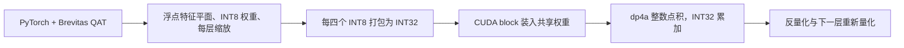

对应 PDF：`Towards_Comprehensive_Neural_Materials_SIGGRAPH2025_supplement.pdf`，共 2 页。本文页码均指 PDF 物理页，从 1 开始。更新：2026-10-18。

本文基于该本地 PDF；“原文方法”与“UE 接入推断”分开说明。图是帮助理解的流程示意，不是论文原图。

## 这两页的用途

正文说明方法，这份补充材料给复现所需的精度、训练配置、布局和追踪细节。它不应被当作缺失正文的替代品；[正文解析](/projects/neural-bsdf-perf/papers/comprehensive-neural-materials/) 与本文分别保留。

## PDF 1 页：哪些量被量化

第 1.1 节明确使用权重与激活的对称 per-tensor 8-bit signed 量化，不使用 bias；每层需要激活和权重两个缩放参数。三张特征平面保持 FP32，方便插值。将论文解释为“整个特征资产都 INT8”是错误的。

表 1 的 U 平面为 `400×400×8` 或 `800×800×8`，H/D 平面各 `50×50×8`。例如 `400×400×8×4` 字节约为 4.88 MiB；U 平面才是较大的存储项，小网络权重不是总资产体积。论文表中的 MB 是容量展示，比较时应统一十进制/二进制单位。

第 1.2 节区分实测 UBO2014 BTF 与合成材质。实测例子是 400×400、22,801 张角度组合图；合成数据为 800×800、10,000 张图。两类数据的空间与角度配置不能混算成同一个训练集。

第 1.3 节使用 AdamW、余弦退火和 warm restarts；文中给出最多 300 epochs、RTX 4090 上约 18 小时的实验设置。它是作者该配置下的耗时，不是本地运行承诺。

## PDF 1–2 页：怎样在 GPU 上推理

权重四个一组打包到 INT32；平面用两层 float4 CUDA texture 存储；block 内先将权重装入 shared memory。使用 `dp4a` 做四个 8-bit 元素的点积，INT32 累加；中间结果再转回浮点并为下一层量化。

`Inference.cu` 第 133 行是核心调用（只记录读法，不转载源码）：把一个打包的 INT32 激活和一组打包的权重做 `__dp4a`（四个 8-bit 元素的点积），结果累加到该输出通道的 INT32 累加器上。

这个调用依赖前面的打包顺序、常量与缩放；不能孤立替换一个乘法函数就认为完成了等价移植。

## PDF 2 页：合成与位移细节

第 1.5 节用三次 Bézier 曲线修改 ACF：端点固定为 `(0,0)`、`(1,1)`，两个内部控制点可编辑，再求相应曲线位置。它调的是 patch 选择分布。

第 1.6 节与图 2 给出 shell 内粗、细级追踪。先找粗级可能相交的 cell，然后从该 cell 的起始位置在细级行进，细级最多 32 步，得到最终交点。不是从粗级交点任意继续走 32 步，也不是对所有材质只做两个射线步进。

## 本地配置差异与 UE 接入推断

当前 QuantizedTriplePlane 构造器 默认 `dimU=16`，而本文表 1 是 8；导出资产和内核必须与实际训练配置配对。论文没用 bias，导出器即使生成名为 Bias 的文件，也不能因此反推论文使用了普通带偏置层。

**UE 接入推断：**优先制作少量固定输入的数值对照，验证 signed INT8、打包字节顺序、缩放、中间精度和平面坐标；之后再验证图像。当前下载代码尚未在本机训练或构建，本文没有把文件存在当作复现实验成功。
