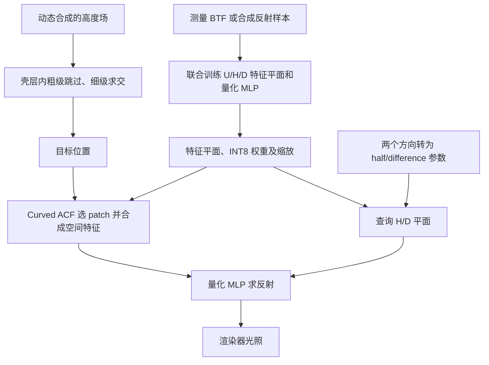

对应 PDF：`Towards_Comprehensive_Neural_Materials_SIGGRAPH2025_author.pdf`，共 11 页。本文页码均指 PDF 物理页，从 1 开始。更新：2026-10-18。

本文基于该本地 PDF；“原文方法”与“UE 接入推断”分开说明。图是帮助理解的流程示意，不是论文原图。

## 三条路线共同组成材质

论文把反射重建、运行速度、把小样本铺到大表面，以及近景位移/轮廓放在同一问题中。不能只用一个 BTF 拟合网络概括全部贡献，也不能把轮廓效果归因于反射网络自动学到了几何。

## 原文方法拆解

**QTP，PDF 4–6 页。** 空间位置 `u`、半向量参数 `h`、差向量参数 `d` 分别查询 U、H、D 三个二维特征平面，拼接后输入量化网络。正文公式 1 把空间合成作用在 U 平面上。`u` 在这里是二维空间位置，不是单个标量纹理分量。

权重和激活使用对称的 per-tensor INT8 量化；点积使用 INT32 累加，再用缩放恢复浮点值。特征平面本身仍保持浮点以支持插值。因而“INT8 材质”不等于资产里所有字节都是 INT8。

**Curved ACF 合成，PDF 5–6 页。** ACF 衡量 patch 之间的相似性；改变其映射曲线，控制采样时偏向结构相近的区域还是引入更多随机变化。选择 patch 与混合 patch 是两个不同步骤。它用示例材质生成更大范围外观，不能据此声称能任意修改原始物理层参数。

**动态位移追踪，PDF 6–7 页。** 用合成高度场的粗、细级别求交，粗级跳过空区域，细级定位表面。高度场 tracing 的 LOD 与反射 U 平面的外观 LOD 作用不同。由实际交点改变 UV 和轮廓，才获得视差及剪影。

## 本地训练和推理链路

训练工程 `train_qtp.py` → `networks.py:107` → `export_weights.py` → 渲染工程 `Inference.cu`。

`networks.py` 第 126 行起是前向过程（只记录读法，不转载源码）：H、U、D 三个平面分别用对应的输入取出特征，把三份特征拼接后交给 MLP，输出取前 3 个通道（RGB）。

当前构造器默认 U 平面通道是 16，而补充材料表 1 中论文配置是 8。工程默认值与论文实验不是同一份配置，做容量/存储对比必须显式指定。

## 例子：将一小块皮革铺到带弯曲轮廓的物体

BTF 样本提供原始 patch 的方向响应；U 平面描述皮纹位置，H/D 平面表达方向变化。合成器挑选合适的空间 patch，避免完全随机拼接打断皮纹；高度场求交使近景皮纹出现视差。最终交点处再用 QTP 求反射。三个模块都参与结果，但职责不同。

## 证据、限制与 UE 接入推断

PDF 7–9 页分别看重建、LOD、合成及位移实验；性能比较要区分独立推理/合成计时与整帧渲染计时。高度场形状会改变追踪成本，不能用单个演示数字作为统一预算。

正文 PDF 5 页明确把重要性采样视为正交问题，本文不解决它。因此它不提供与 NVIDIA 神经外观系统完全等价的“求值 + 专用采样器”方案。

**UE 接入推断：**先对齐三平面坐标、量化缩放及响应约定，再研究合成和高度场。CUDA 实现不能直接贴入 UE HLSL；接入完整路径追踪仍需合适的方向采样及 PDF。详细内存布局见 [补充材料解析](/projects/neural-bsdf-perf/papers/comprehensive-neural-materials-supplement/)。
