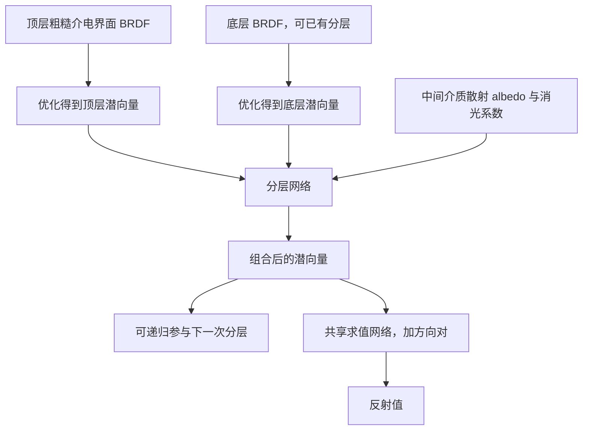

对应 PDF：`Neural_Layered_BRDFs_SIGGRAPH2022_author.pdf`，共 8 页。本文页码均指 PDF 物理页，从 1 开始。更新：2026-10-18。

本文基于该本地 PDF；“原文方法”与“UE 接入推断”分开说明。图是帮助理解的流程示意，不是论文原图。

## 与固定材质烘焙的不同

Ling-Qi Yan 是该工作的共同作者。核心是学习 BRDF 表示及潜空间分层操作，不只把最终完整材质图固定后拟合一个网络。

## PDF 2–4 页：表示网络没有固定编码器

第 3.2 节采用 decoder 加可优化潜向量。训练阶段同时更新网络权重与训练集各 BRDF 的潜码；面对新的 BRDF，冻结 decoder，只优化新潜码，使任意所需方向采样上的重建接近参考。图 4 的两条反传路径分别对应这两个对象。

因此“将 BRDF 编码成潜向量”是概念流程，不意味着原文必有一个一次前向完成全部投影的 encoder。新的潜码拟合仍需要优化。

原文简化假设包括各向同性 BRDF、没有 normal map。法线变化可在着色坐标系外部处理，但不能据此认为网络已经学会多层各自独立法线。

## PDF 4 页：分层网络究竟能组合什么

第 3.3 节和图 5 的设置是：顶层为 rough dielectric BSDF，其界面透射由反射的能量补量隐含表达；底层为任意可表示 BRDF；中间为均匀参与介质，参数含散射 albedo 与消光系数，并假设各向同性散射。

分层网络消费两个潜向量和介质参数，输出新的潜向量。递归组合可以得到多层结果，但仍受所学分层设置约束，不等于任意 Substrate 节点组合的通用算子。

## PDF 5 页：运行时与采样

第 4.3 节描述先收集路径追踪查询到 buffer，再在 GPU 上批量推理，使用 CUDA/CUTLASS。采样另有小网络预测包含 Gaussian 与 Lambertian lobe 的 PDF 代理，并用于 MIS。不能把求值 decoder 的输出直接当作 PDF。

这是较早的批处理集成，与 NVIDIA 2024 强调 ray shader 中内联小网络的路线在执行方式上不同。两者都能表示反射，但不代表吞吐、分歧和延迟成本相同。

## 沿清漆覆盖底色的例子理解

先将清漆界面和底层材质分别拟合到潜空间；分层网络再结合中间介质参数，得到合成后的 BRDF 潜码。路径命中时用这个潜码与方向对查询反射。若底层已是一组组合材质，可继续使用其潜码递归分层。

示例只解释论文算子的使用方式，不声称默认训练域包含任意清漆厚度、薄膜干涉或各向异性织物。

## 阅读定位、限制和 UE 接入推断

PDF 3 页看投影与 decoder；4 页看层间物理假设；5 页看渲染管线；6–7 页看复杂案例、测量材料与限制。第 5.3 节指出 BTDF 仅隐含处理，多个分离 lobe 和高度镜面材料也更难预测。

**UE 接入推断：**这篇更适合启发“可组合神经分层”，但要保留 Substrate 的编辑能力，必须先列清楚待支持算子、法线、介质参数及训练域。当前 NA 中只收录该论文，没有经核实的这篇作者实现仓库；不要将 Comprehensive 或 neuralappearance 标为它的复现代码。
