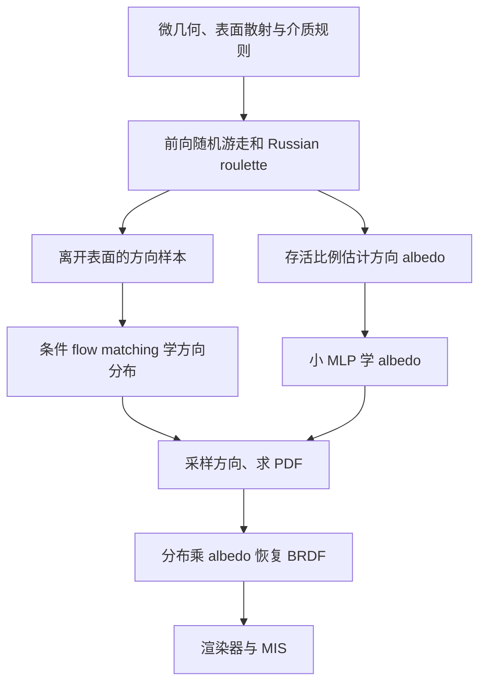

对应 PDF：`PureSample_Neural_Materials_arXiv_2508.07240.pdf`，共 16 页。本文页码均指 PDF 物理页，从 1 开始。更新：2026-10-18。

本文基于该本地 PDF；“原文方法”与“UE 接入推断”分开说明。图是帮助理解的流程示意，不是论文原图。

## 先看训练信号来自哪里



不必先为每种复杂微几何手工推导完整 BRDF，再用它生成监督值。只要能模拟局部散射和随机游走，就能从样本学习分布与总能量。

## PDF 5 页：分解公式与概率测度

第 4.1 节先对无空间变化的标量 BRDF 写出精确分解：

```text
f(\omega_i,\omega_o)=\rho(\omega_o\mid\omega_i)\,\alpha(\omega_i),\qquad
\alpha(\omega_i)=\int f(\omega_i,\omega)\,d\sigma_\perp(\omega).
```

`rho` 是相对于**投影立体角**的归一化密度，`alpha` 是方向相关反照率。渲染器常用普通立体角 PDF，转换时必须乘对应余弦因子。若忽略测度，公式看似正确，MIS 权重和能量却会错。

第 4.2 节解释拒绝/存活采样：用 Russian roulette 吸收路径权重，让存活粒子的方向分布代表归一化散射形状，接受比例估计能量。不是只数所有离开方向而完全忽略吸收。

## PDF 6 页：网络如何支持三个接口

方向分布使用条件 flow matching，条件含入射方向与颜色通道；空间变化时再加潜纹理。基准方案用 ODE 积分生成样本；PDF 求值通过反向流、梯度及 Jacobian 累积计算。

albedo 网络输出 RGB。采样时根据各通道 albedo 选择通道，再条件采样方向；MIS 使用所有颜色通道形成的混合 PDF，不能仅返回被选通道的条件密度。BRDF 求值也按各通道组合，部分网络结果可以复用。

空间变化版本先联合优化 flow 与潜纹理，再冻结潜纹理训练 albedo 网络，并增加 TV 正则抑制潜纹理噪声。不要把均匀材料的网络宽度直接套用到空间变化版本。

第 5.5 节的 MeanFlow 和 PDF distillation 是可选加速：前者减少采样步骤，后者减少 PDF 求值成本。单步采样不意味着它的精确 PDF 也自动只需同一次单步计算。

## 一个分层微结构例子

光线进入具有微表面和中间介质的结构后，多次反射、散射或被吸收。离线只记录其最终离开方向和存活统计；训练后宏观渲染无需每次重走内部微路径，改为查询分布与 albedo，再继续外部场景路径。

这解决局部微结构的统计散射，不生成物体宏观轮廓，也不自动处理跨不同表面的相干波干涉。

## 阅读定位与证据边界

PDF 4 页看微几何和概览；5 页看分解与样本估计；6 页看网络、RGB、MIS 和加速；7–8 页看实验与限制。此本地 arXiv PDF 后半部分还含附加讨论及图例，不能因文件名带早期 arXiv 编号就断言是初稿。

第 6.4 节明确：当前针对半球反射，透射全球扩展是可能方向；不包含中/宏观视差，材质参数改变需要重训，也未解决实测数据训练。

**UE 接入推断：**它是研究“统一求值和采样”的替代路线，接入成本必须包含 ODE/PDF 的计算。当前 NA 没有这篇经核实的作者源码，不应把 RTXNS SDK 当作其实现。与本地 `神经材质 eval/sample/pdf 接口` 只能作职责对比，不能混用权重。
