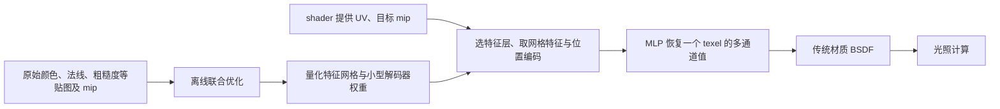

对应 PDF：`Random-Access_Neural_Compression_of_Material_Textures_SIGGRAPH2023.pdf`，共 15 页。本文页码均指 PDF 物理页，从 1 开始。更新：2026-10-18。

本文基于该本地 PDF；“原文方法”与“UE 接入推断”分开说明。图是帮助理解的流程示意，不是论文原图。

## 先看数据由谁产生、保存和消费

它学习的是纹理值随坐标和尺度的变化，不以入射/出射方向为核心输入。多张材质贴图同一位置往往存在相关性，例如涂漆区域的颜色、金属度和粗糙度会一起改变；联合表示利用这种相关性，避免完全独立压缩每张图。

## 原文方法与阅读定位

| PDF 页 | 要读的内容 | 关键含义 |
|---|---|---|
| 4–5 | 第 4 节、图 4 | 同时利用空间、通道和 mip 之间的冗余 |
| 5 | 特征网格、模拟量化 | 训练时也考虑有限精度存储带来的误差 |
| 5–6 | 特征取样和位置编码 | 单个查询只读取局部特征，不解压整张图 |
| 7 | 第 5 节、图 7–8 | 压缩、解码实现及随机过滤 |
| 8–10 | 第 6 节 | 纹理重建质量、渲染质量与耗时分别评估 |
| 11 | 第 7 节、图 12 | 细节丢失、偏色、通道串扰等失败情况 |

图 4 中每个特征层有高、低分辨率网格。高分辨率侧取邻近特征，低分辨率侧使用插值，再拼接位置编码和归一化 LOD，交给 MLP 预测目标通道。不能把这一结构简化理解为“UV 直接送进一个网络”。

随机过滤的作用是减少一次着色所需的完整解码次数，再依赖时空积累形成稳定结果。它涉及随机数、采样分布和重建，不能等同于普通硬件双线性过滤。图 8 还说明：先过滤参数再做非线性着色，与在样本上着色后积累，结果可能不同。

## 本地源码如何接上论文概念

本地 SDK 是后续工程实现，不保证与 2023 论文的网络和精度完全一致。真实调用点见 `NtcForwardShadingPass.hlsl:70`。普通和 CoopVec 路径解码到 `channels`，随后回填传统材质；第 92 行起 处理 base color，第 121 行附近 处理粗糙度和金属度。以当前文件实际字段为准，不把论文图示当作 SDK API。

## 沿一个例子理解

一个带划痕的金属球需要颜色、法线、粗糙度和金属度。离线将贴图组一起编码；渲染某像素时，shader 用 UV/mip 解出该位置的全部通道，再执行原来的金属 BSDF。划痕变清晰来自更好的纹理重建，光照模型仍由引擎决定。

## 结果、边界和 UE 接入推断

原文展示了低码率下保留细节的能力，但不能把单材质集测试当作任意大量材质场景的性能保证；第 5.2 节讨论了 SIMD 分歧。高频噪声、尖锐边界和弱相关通道仍可能受损。

**UE 接入推断：**适合从资源/材质输入层着手，与 Substrate 共存。验证时记录磁盘大小、GPU 常驻内存、解码时间、距离变化和时间稳定性；不要只用一张静态放大截图判断收益。它不直接替代 Substrate 的分层反射或光照积分。
