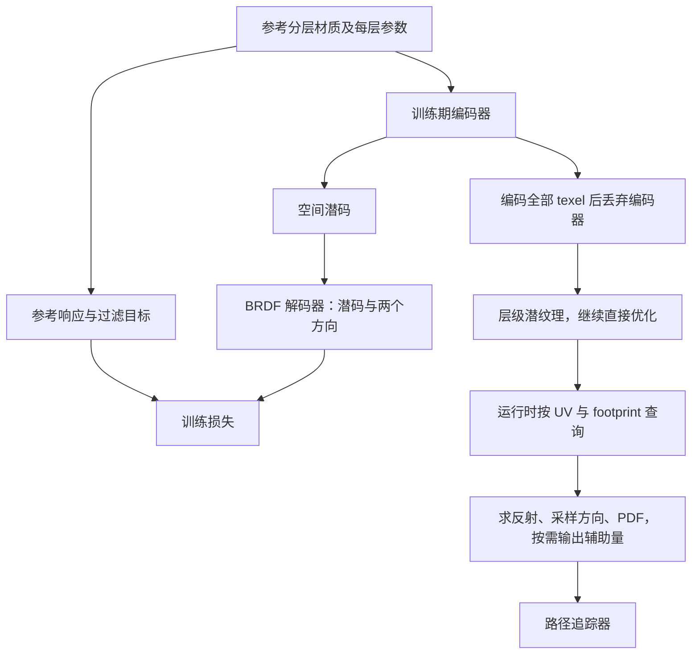

对应 PDF：`Real-Time_Neural_Appearance_Models_SIGGRAPH2024_author.pdf`，共 17 页。本文页码均指 PDF 物理页，从 1 开始。更新：2026-10-18。

本文基于该本地 PDF；“原文方法”与“UE 接入推断”分开说明。图是帮助理解的流程示意，不是论文原图。

## 全局关系

与神经纹理不同，这里的网络近似方向相关的反射函数。参考图可能有多个法线、切线和层间操作；网络用一个紧凑表示承担整体响应的求值。

## 原文方法

第 4 节与图 6（PDF 5–6 页）解释两个重要设计。第一，潜纹理保存空间变化，方向只在查询时输入，从而避免为所有位置与方向显式建表。第二，解码器学习 shading frames，把方向变换到更适合局部结构的坐标系，减少小网络直接拟合高频变化的负担。

图 6 的训练并非从头到尾只训练同一个编码器：先训练“参数→潜码→响应”；随后把编码器作用于所有 texel，生成潜纹理；再移除编码器，直接优化潜纹理及解码器。运行时不需要重新读取原始全部材质图参数。

LOD 的目标是不同像素 footprint 下的**过滤后外观**。潜码的数值平均一般不等于真实反射平均；论文通过多尺度训练，让每层潜纹理对应过滤后的材质。PDF 5 页图 5、6 页图 6 和 8 页的过滤分析应放在一起读。

重要性采样有单独解码路径，产生分析分布的参数，用于方向采样和 PDF。它并非与求值网络完全无关的任意采样器，也不要求每次都用大网络产生一个方向。

## 本地对照源码

下面只记录读法和文件位置，不转载源码。

`neural_material.slang` 第 45 行附近是**求值**：先从潜纹理做双线性随机采样，用材质编号、mip 级别和击中点 UV 取出潜码，再把潜码与入射、出射方向一起送进解码器的前向。

同文件第 66 行起是**采样**：采样器根据入射方向和一个随机数给出出射方向，再把它从局部坐标系换到世界空间的着色坐标系；pdf 由同一个采样器按入射方向、出射方向和同一组参数给出。

这是当前本地仓库的实现例子；仓库直接配套的是 2026 年训练论文，不能据此声称它逐项复现 2024 版实验。

## 用带釉陶瓷串起来

参考材质包含陶瓷、釉层、指纹和灰尘。离线在位置、方向和 footprint 上采样参考响应；训练出的潜纹理记录空间差异。相机命中陶瓷后，路径追踪器取潜码，查询反射或生成下一跳方向，再继续处理场景可见性与光照。网络压缩的是材质响应，不包含整幅图像的阴影和全局光照。

## 结果怎样读、什么没有保证

PDF 10–14 页讨论内联网络、硬件矩阵运算、执行一致性、模型大小和多材质可扩展性。速度比较必须同时看网络尺寸、硬件、采样数、分辨率及参考材质复杂度。

PDF 15 页明确说明：近似网络不保证严格能量守恒或互易性；本文也不完整覆盖 delta 分量与折射。不要将局部反射模型扩写成通用光传输求解器。

**UE 接入推断：**先验证相同输入下的响应、坐标系、余弦约定和 PDF，再进入完整材质路径。2025 年课程资料另外给出了真实 UE/Substrate 集成案例，见 [课程讲义解析](/projects/neural-bsdf-perf/papers/bridging-course-notes/)。
