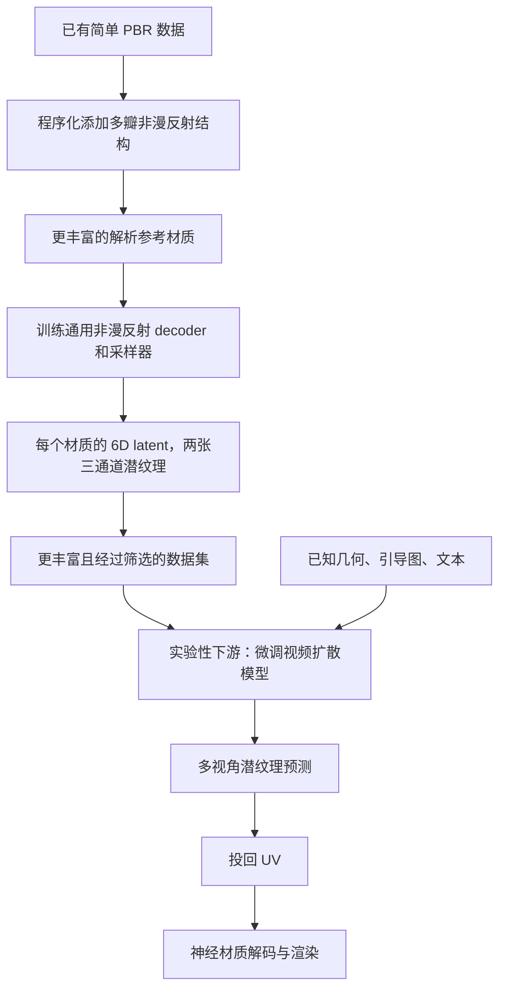

对应 PDF：`Toward_Richer_Material_Generation_SIGGRAPH2026_author.pdf`，共 11 页。本文页码均指 PDF 物理页，从 1 开始。更新：2026-10-18。

本文基于该本地 PDF；“原文方法”与“UE 接入推断”分开说明。图是帮助理解的流程示意，不是论文原图。

## 先分开数据增强、表示和生成三阶段

论文首先解决“训练数据里的材质太简单”，其次给出生成应用。它不是把文本直接编译成 UE 材质图，也不是单纯的纹理压缩论文。

## PDF 3–4 页：程序化增强改变了什么

简单 PBR 常由 diffuse 和一个 GGX specular 组成。作者保留 Lambertian diffuse，扩展非漫反射部分为八个 lobe 的混合/涂层结构，包含金属/介电 core、haze，以及 dust、clearcoat、sheen 和 subsurface-like 等装饰成分。

参数采样并非所有维度一律均匀随机；作者引入基于物理和制作经验的分布，使训练更集中覆盖合理且重要的外观。PDF 5 页图 7 比较 informed 与纯随机数据，说明同等训练资源下数据分布会影响拟合质量。

## PDF 5–7 页：共享潜空间与能量

通用 MLP 消费 6D 潜码和方向，输出非漫反射响应、传输 albedo 与反射能量估计；采样器另行训练。漫反射保留在外部，便于颜色编辑与下游处理。公式 2 用预测透过非漫反射层的能量加权 diffuse，不是无约束地把两部分相加。

将 22 个输入参数压到 6 个潜通道，容易让有效材质附近出现非法区域。作者用随机 infill 材质填充潜空间，并在训练时给 latent 注入小噪声，让解码对扰动更稳。非线性网络近似仍可能破坏守恒，故用放宽的 white furnace test 筛选组合材质；PDF 7 页说明所测数据约 90% 通过。这不是对所有生成材质的数学守恒保证。

## PDF 7–9 页：生成只是下游示例

图 9 给定 3D 物体和文本，渲染多视角 normal、position、base color guides；通过视频模型生成视角中的潜纹理，再投回纹理空间。共有 16 个视角的条件和输出，不等于用普通视频帧作为最终 BRDF。

PDF 9 页图 11 讨论非法 latent、UV 岛和覆盖不足的轮廓区域。作者对未覆盖区域做侵蚀修补并回退 diffuse；这体现生成、UV 投影和有效材质约束仍会失败。图 13 的微观 glint 是另加的程序化增强示例，不应归因于视频模型已经学会了波动光学。

## 用金属雕像串起来

原始金属贴图先被增强为包含 core、高光 haze、灰尘/清漆变化的参考外观；该外观拟合到共享潜空间。生成模型在已有雕像几何和多视角引导下输出潜纹理；渲染器仍需解码反射、计算采样和光照。网络生成的是材质表示，场景阴影与间接光仍由渲染器负责。

## 与本地库的关系及 UE 接入推断

本地 neuralappearance 可以帮助理解潜纹理与方向解码，但不是这篇“通用 6D 材质 + 数据增强 + 视频生成”的完整代码；NA 中当前仅有论文，不能拿现有库默认权重直接当作该模型。

**UE 接入推断：**先跑通固定神经材质，再考虑共享 decoder、多材质资产与生成。导入生成结果时仍需验证潜纹理通道、base color 的分工、辅助 albedo、采样及有效性；它不替代 Substrate 的编辑器，也不让 UE 自动理解任意 latent。
