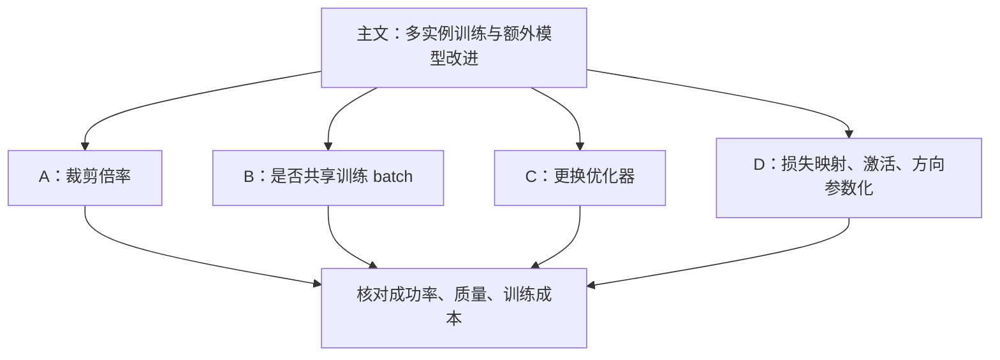

对应 PDF：`Taming_Optimization_Variance_SIGGRAPH2026_supplement.pdf`，共 7 页。本文页码均指 PDF 物理页，从 1 开始。更新：2026-10-18。

本文基于该本地 PDF；“原文方法”与“UE 接入推断”分开说明。图是帮助理解的流程示意，不是论文原图。

## 这份补充材料回答什么

这是 7 页补充材料，重点是主论文结论背后的实验，不是另一种神经材质模型。应与 [正文解析](/projects/neural-bsdf-perf/papers/taming-optimization-variance/) 一起阅读。

## 按页解析

**PDF 1 页，A：裁剪计划。** 比较 2、4、8 倍裁剪。64 个初始实例分别经过不同长度的计划降至 1，同时增加 batch。所测情形下倍率影响较小；这意味着默认倍率不是论文收益的唯一来源，而不是所有裁剪时间和规则都无关紧要。

**PDF 2–3 页，B：共享数据。** 多个实例使用相同训练 batch，能降低生成样本的成本，也让它们的损失更可比。独立 batch 可能增加探索，但短期损失还会混入不同样本难度的影响。作者用“保留全部实例、模拟裁剪”的实验判断早期选择是否可靠。

不共享时，最终留下绝对最佳候选的平均频率为 72.4%，正文共享设置为 79.1%；这两个是特定实验的选择频率，不是训练总体成功率。表 2 中留下实例的最终损失与最佳实例之比平均约 1.015，随机实例约 1.953。真正有用的观察是：没有每次选到第一名，也可能已非常接近最优。

**PDF 3 页，C：优化器。** Adam、Muon、SOAP 会改变收敛速度，但在该实验中都仍出现显著初始化方差。更换优化器没有自动消除多实例探索的动机。

**PDF 4–6 页，D：额外改进。** 表 3 比较损失映射；表 4–5 比较 ReLU、LeakyReLU、LeakySmeLU；表 6–7 比较方向输入。作者同时报告 HDR FLIP 和训练损失，并用多个初始化统计均值和离散程度。

## 如何避免误读表格

| 表格现象 | 正确解释 |
|---|---|
| 不同损失映射的 loss 不同 | 目标函数本来就不同，不能直接按数值大小排名 |
| 某激活在平均 FLIP 上较好 | 不保证每种材料都最好，逐行仍有反例 |
| 淘汰后没有留下 rank 1 | 还要看最终误差距离和节省的成本 |
| loss 降低，图像差异仍可见 | 训练目标与感知指标并非同一量 |

例如一种金属的窄高光主要位于少数角度：某参数化平均 loss 小，并不代表所有观察方向都无偏。应该将材质球、平面和角度切片对照。

## 本地复现与 UE 接入推断

从 `multi_instance_training_small.json` 开始，与相同尺寸的单实例配置比较；分别记录多个 seed、墙钟时间、最终误差与网络尺寸。这些是建议实验，本机尚未运行。

这份材料对 UE 的贡献在离线质量控制：选出在固定运行时预算下更可靠的权重，不改变 Substrate 必须提供哪些光照数据。训练/验证数据共享与评估独立性也应区分：共享的是候选之间的训练 batch，不意味着可以用训练样本替代最终验证。
