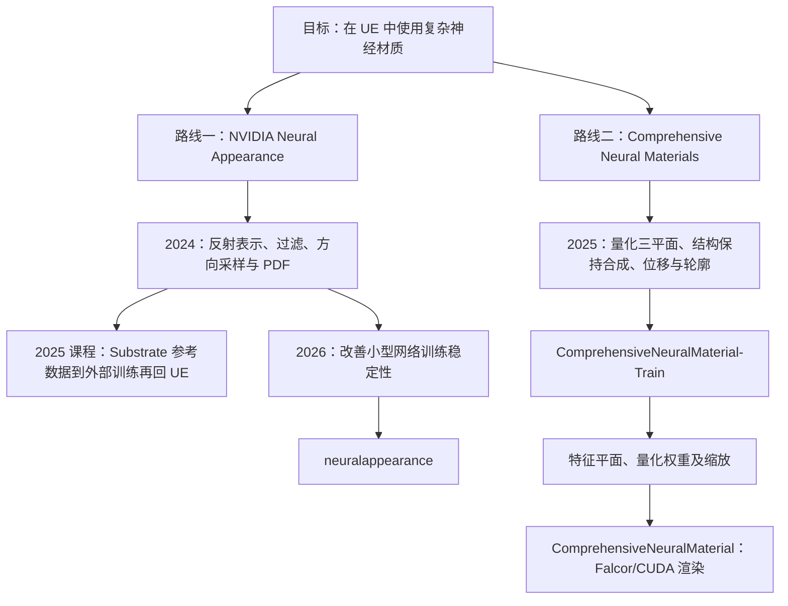

更新：2026-10-22。本文回答：神经技术在游戏引擎各模块中是什么样子、本项目在哪里、神经材质该怎么研究。先给出神经技术在游戏引擎各模块中的全景（渲染、动画与物理、其他模块），说明本项目所在的位置；第 2 节起是图形方向的专题：材质与光照的边界、神经外观的组成、神经材质的两条研究路线和阅读顺序。

## 1. 全景地图

本项目的思路是：**保留传统引擎的模块分工，把其中某一块换成神经网络**。这条思路与 UE 的结构契合。下面按引擎模块列出，「落地程度」指在商业游戏和引擎中的成熟度；较新的条目以厂商官方资料为准。

### 1.1 渲染

| 环节 | 传统做法 | 神经化的做法 | 代表工作 / UE 与生态现状 | 落地程度 | 本项目 |
|---|---|---|---|---|---|
| 几何 | 网格、Nanite、位移 | 神经 SDF、神经位移、神经 LOD | 基本没有现成方案，以研究为主 | 低 | — |
| 纹理 | BC 压缩的贴图 | NTC（神经纹理压缩） | NVIDIA RTX Neural Texture Compression SDK，需自行集成 | 低：SDK 可用，商业游戏中少见 | — |
| **材质** | 解析 BRDF、Substrate | 神经 BSDF / 神经外观 | **UE 中没有现成集成** | 低 | **当前主线** |
| 特殊材质 | 头发、皮肤、布料等昂贵着色模型 | 神经材质的细分方向 | 以研究为主 | 低 | — |
| 角色渲染 | 皮肤、毛发着色与面部细节 | 针对人脸的神经增强 | NVIDIA RTX Neural Faces 一类，较新 | 低 | — |
| 光照 | 阴影、GI、Lumen | 神经辐射缓存（NRC）、神经 GI | NVIDIA RTXGI SDK 含 NRC，NvRTX 分支有部分集成（版本需核实） | 低到中 | — |
| 重建 / 后处理 | TAA、TSR、降噪 | ML 超分、帧生成、神经降噪（Ray Reconstruction） | NVIDIA DLSS、AMD FSR 4、Intel XeSS、PS5 Pro 的 PSSR | **高**：各硬件平台的标配 | — |
| 远景与替身 | 低模、impostor | 用小网络或神经纹理代替远处的植被和复杂物体 | 以研究为主 | 低 | — |
| 通用神经 shader | 手写 shader 函数 | 用小网络拟合任意 shader 函数 | RTX Neural Shaders / RTXNS（本地 `RTXNS`） | 低：较新 | — |

神经材质在 UE 中恰好是「研究基础充分、但没有现成集成」的一块，这也是本项目的价值所在。

### 1.2 动画与物理

动画：

| 方向 | 做法 | 代表工作 | 落地程度 |
|---|---|---|---|
| 从离线模拟学变形 | 离线跑高精度模拟（肌肉、脂肪、布料），网络在运行时近似二次变形 | UE 的 ML Deformer | 高：已进入引擎 |
| 学习式动作匹配 | 用网络压缩 Motion Matching 的动作数据库，省内存 | Ubisoft La Forge 的 Learned Motion Matching | 中 |
| 语音驱动面部动画 | 输入语音，输出口型与表情 | NVIDIA Audio2Face（ACE 的一部分） | 中 |
| 视频动捕 | 从普通视频估计面部或全身姿态，不需要动捕设备 | MetaHuman Animator（手机视频做面部动捕） | 高 |
| 自动绑定与蒙皮 | 预测骨骼位置和蒙皮权重 | 研究与 DCC 工具 | 中 |

物理（按网络在模拟中扮演的角色）：

| 类别 | 做法 | 代表工作 | 落地程度 |
|---|---|---|---|
| 替代求解器 | 网络直接预测下一帧状态，替换整个模拟器 | DeepMind 的 GNS、MeshGraphNets；各类神经布料模拟 | 低：泛化和长时间稳定性难保证，换物体或跑久了容易漂移、发散 |
| 加速传统求解器 | 求解器框架不变，只把最贵的一步交给网络 | 用 CNN 做烟雾流体的压力投影；学习的预条件子；神经 PDE 求解器（如 FNO） | 中：以研究为主，但比替代求解器可控 |
| 细节增强 | 粗模拟保证运动，网络补细节 | 烟雾超分辨率（如 tempoGAN）；布料细褶皱 | 中 |
| 从离线模拟学变形 | 同上表 ML Deformer | UE 的 ML Deformer | 高 |
| 物理角色控制 | 角色本身是物理模拟的刚体，用强化学习训练控制器完成动作 | DeepMimic、AMP、ASE 系列；UE 的 Learning Agents | 中：研究活跃，商业游戏中有限使用 |

渲染的误差只影响当前画面，通常可以接受；物理的误差会随时间累积，可能导致穿模或发散，还要满足碰撞、守恒等约束。所以游戏中更常见的是「网络辅助、传统求解器兜底」，而不是让网络完全替代求解器。

### 1.3 引擎其他模块

| 模块 | 神经工作 | 代表工作 | 落地程度 |
|---|---|---|---|
| AI / NPC | 大语言模型驱动的对话 NPC；强化学习训练的 bot 与对手 | NVIDIA ACE、Inworld；UE Learning Agents | 中：对话 NPC 尚在早期，bot 已较常见 |
| 音频 | 语音合成（NPC 配音、本地化）、神经音频编解码、声音传播的代理模型 | 各家 TTS；NVIDIA ACE 的语音部分 | 中 |
| 内容生产工具 | 纹理与材质生成、文本或图片生成 3D、旧资产超分、地形生成、UV 与 LOD 辅助 | 各家 DCC 与引擎插件 | 中到高：离线工具门槛最低，普及最快 |
| 测试 / QA | 自动化测试 bot、视觉 bug 检测（穿模、贴图丢失）、崩溃日志归类 | EA SEED、Ubisoft La Forge 的公开研究 | 中 |
| 反作弊与安全 | 从玩家行为识别外挂；检测语音和文字中的不当内容 | Valve 的 VACnet；Modulate 的 ToxMod | 高 |
| 网络与流媒体 | 云游戏的视频编码、网络延迟预测 | 主要在平台方 | 中 |
| 运营 | 推荐、流失预测、难度动态调整 | 各发行商的数据团队 | 高 |

### 1.4 公共底座

所有模块在运行时做的是同一件事：在帧预算内运行小网络。渲染方向多在 shader 内联推理，动画与物理多在 compute shader 或 CPU 上，AI 与音频还可能用 CPU 或 NPU。这套基础设施可以在各模块之间迁移：

| 底座 | 内容 | 本项目 |
|---|---|---|
| 推理运行时 | 权重放在哪里、怎样打包、fp16 / INT8、寄存器与占用率 | 常量缓冲权重、形状特化、fp16 / dp4a（[性能报告](/projects/neural-bsdf-perf/performance/)） |
| 硬件加速 | tensor core、cooperative vector（SM 6.9）、各厂商的 shader 内矩阵指令、CPU 与 NPU | Roadmap M5 |
| 引擎框架 | UE 的 NNE（Neural Network Engine），面向 CPU 与独立的 GPU 推理，不是 shader 内联推理 | 本项目把权重直接放进 shader，属于另一种做法 |
| 训练与数据管线 | 生成参考数据、训练、导入引擎、对比误差 | 引擎内捕获、训练、同路径对比（[捕获与对比](/projects/neural-bsdf-perf/capture-and-comparison/)） |

### 1.5 暂不考虑的路线

| 路线 | 做法 | 为什么暂不考虑 |
|---|---|---|
| 辐射场（NeRF、3D 高斯） | 从多视角照片直接学最终画面，几何、材质、光照混在一起 | 光照被烘焙进表示，难以重光照、换材质和交互；适合重建、XR、数字孪生。严格说 3D 高斯不含神经网络，是可微光栅化优化出的显式图元 |
| 生成式 / 世界模型 | 用视频模型直接生成画面 | 几乎抛开传统管线，离可控的实时游戏渲染还远 |

两类路线正在靠近：可重光照的高斯（Relightable Gaussians）尝试从照片中重新拆出几何、材质和光照，需要的正是材质的表示与求值。

### 1.6 最值得关注的三件事

1. **神经超分已经是全平台标配**：NVIDIA、AMD、Intel、Sony 都有 ML 超分。图形岗位要能讲清它与 TAA / TSR 的区别（时序累积加网络重建），以及它对渲染管线的要求：运动向量、抖动采样、反应遮罩、透明物体的处理。
2. **数字人是渲染、动画、音频的交汇点**：MetaHuman、Audio2Face、神经人脸渲染组合在一起，是目前游戏中神经技术最集中的地方。
3. **公共底座通用**：小网络推理的优化（量化、打包、占用率、带宽）在渲染、动画、音频中是同一套功夫。

## 2. 材质与光照的边界

神经外观负责「表面怎样反射光」，不负责「光在场景中怎样传播」：阴影、GI、Lumen、反射、降噪仍由引擎完成。两者通过接口相连，而许多光照算法默认材质是解析 BRDF（如 GGX），神经材质要逐一提供替代：

| 光照算法 | 需要材质提供 | 神经材质的处理 |
|---|---|---|
| 点光、方向光（直接光） | `eval(ωi, ωo)` | 已实现（延迟光照） |
| 路径追踪、光追反射 | `sample` 与 `pdf`，用于重要性采样 | 采样网络（NVIDIA 2024），或用解析近似的 pdf |
| 环境光 / IBL | 半球预积分的响应；UE 的 split-sum 依赖 GGX 的 roughness 查预滤波 cubemap | 给网络加环境光输出头，或拟合等效的 roughness 与 F0 |
| Lumen GI、反射 | Lumen 只读取简化参数（base color、roughness、法线等），不调用完整 BRDF | 逐 texel 的代理参数（Roadmap M4） |
| 面光源（LTC 等） | 针对 GGX 拟合的 LTC 系数 | 代理参数或专门的输出 |
| 次表面、透射、多层 | Substrate 按 closure 分别处理 | 目前只作为不透明反射 |

用神经网络来做光照本身（NRC、神经降噪、神经 GI）属于全景 1.1 中的「光照」与「重建」，与神经材质相互独立，可以叠加。

## 3. 神经外观的组成与本项目覆盖

| 环节 | 做什么 | 本项目现状 |
|---|---|---|
| 训练 / 蒸馏 | 从教师材质得到潜纹理和网络权重 | 已有：引擎内捕获 Substrate 渲染结果训练，同路径误差 11.8% |
| 存储 | 潜纹理与权重放在哪里、占多少显存 | 部分：权重在常量缓冲，潜纹理未压缩（NTC 可补） |
| 查询与过滤（LOD） | 远处一个像素覆盖多个 texel 时怎样平均 | 缺：论文把 mip 层级作为网络输入训练，或用随机过滤 |
| 求值 | 给定 ωi、ωo 求 BRDF | 已有：fp16 / dp4a 核，接入 Substrate 延迟光照 |
| 采样 | 按 BRDF 形状生成方向并给出 pdf | 缺 |
| 直接光 | 点光、方向光、阴影 | 已有 |
| 间接光 | Lumen、反射、环境光 | 缺（Roadmap M4） |
| 运行时工程 | 与 Substrate 解耦、编码器 / 解码器两段式、按 tile 启用、cooperative vector | 进行中（Roadmap M2、M5；性能报告的下一步） |

建议的顺序：先做运行时（拆出独立 pass 或 M2 两段式）→ 间接光适配 → 过滤与 LOD → 按需要选择 NTC（显存）或采样（光追）。

## 4. 术语对齐

| 表示 | 核心自变量 | 网络主要预测什么 | 接入渲染器的位置 |
|---|---|---|---|
| 神经纹理 | 纹理坐标 `(u,v)`、mip / LOD，有时含通道或材质条件 | 纹理通道值，或恢复这些值的特征 | 纹理采样 / 材质输入 |
| 神经材质 / Neural BSDF | 入射和出射方向 `(ωi,ωo)`，通常还条件于潜纹理 / 材质参数 | BRDF / BSDF 值，以及采样方向与 pdf | 材质的散射求值与重要性采样 |
| 神经外观 | 系统概念：空间潜变量、神经材质、采样、LOD 与渲染器实现 | 以紧凑表示保留空间变化的高频、分层外观 | 训练、资产表示与渲染时执行的完整链路 |
| 神经 shader | 程序定义的 shader 输入 | 目标 shader 函数或可学习的计算 | 自定义着色器计算阶段 |

例如相机光线击中物体后：NTC 从 UV / mip 解出 base color、roughness 等，再交给传统材质函数；神经外观取同一位置的潜纹理，用入射 / 出射方向求 `f(ωi,ωo)`，并生成重要性采样方向；GratNet 学的是受限条件下衍射表面的角度响应。三者都叫「神经」，接口和误差类型完全不同。

## 5. 神经材质的两条研究路线

两条路线是独立实现，资产格式、权重布局、方向约定和推理代码都不能直接混用。本项目的 latent 模型（10→32→32→3）沿用路线一的思路，QTP 模型（12→32→32→32→3 INT8）沿用路线二的三平面量化表示。

### 5.1 路线一：NVIDIA Neural Appearance

| 资料 | 重点 |
|---|---|
| Real-Time Neural Appearance Models，SIGGRAPH 2024 | 潜纹理、学习的 shading frame、BRDF 求值、采样器、LOD 与内联推理 |
| Bridging the Gap Between Offline and Real Time with Neural Materials，SIGGRAPH 2025 Course | Substrate / UE 数据导出、外部训练、回导、光栅与 Lumen 适配经验 |
| Taming Optimization Variance in Compact Neural Shading Networks，SIGGRAPH 2026 | 多实例探索、早期淘汰和 batch 调度，改善小网络训练稳定性 |

`neuralappearance` 直接配套的是 2026 年 Taming 论文；2024 年论文提供基础方法，2025 年课程补充 UE 工程实践，不能把仓库称为「2024 论文的完整复现」（见仓库 README）。研究库从 MaterialX / MDL 生成训练样本；课程另讲由 Substrate 生成参考数据的路径，本项目的引擎内捕获采用的就是这一思路。

数据流：参考材质 → 离线训练（位置、方向、footprint 对应的响应）→ 潜纹理、求值与采样网络 → UE 导入与资源绑定 → 运行时查询潜码，求反射或生成方向与 pdf → 引擎继续处理光源、可见性、间接光与降噪。

### 5.2 路线二：Comprehensive Neural Materials

论文为 **Towards Comprehensive Neural Materials: Dynamic Structure-Preserving Synthesis with Accurate Silhouette at Instant Inference Speed**（SIGGRAPH 2025，Ling-Qi Yan 为共同作者）。

- 能力：空间 U 平面与方向 H / D 平面提供特征，量化 MLP 重建反射；ACF 引导的合成把小块材质扩展到大表面并保留纹理结构；高度场追踪提供视差与轮廓（轮廓来自求交模块，不是反射网络产生的几何）。三个阶段要分别验证。
- 边界：正文没有解决专用重要性采样，不能默认获得与路线一等价的 eval / sample / pdf 接口；训练需要 BTF 或相应的合成反射数据。
- 工程：训练入口 `train_qtp.py`、导出 `export_weights.py`（`ComprehensiveNeuralMaterial-Train`）；渲染为 Falcor 8.0 / CUDA，核心在 `Source/Falcor/Utils/Neural/cuda/Inference.cu`（`ComprehensiveNeuralMaterial`）。

### 5.3 按问题选资料

| 当前问题 | 资料 |
|---|---|
| 在 UE 中运行神经材质，理解 BSDF 与采样接口 | NVIDIA 2024 + 2025 UE 课程 |
| 小网络训练质量受初始化影响 | NVIDIA 2026 Taming |
| 小样本扩展、结构保持、量化推理、视差与轮廓 | Comprehensive 2025 正文与补充材料 |
| 保留潜空间的分层组合能力 | Neural Layered BRDFs（2022） |
| 通用的分布学习式采样 | PureSample（2026） |
| 贴图显存 | NTC（2023） |
| 衍射等波动光学外观 | GratNet（2025） |
| 材质数据增强与生成 | Toward Richer Material Generation（2026） |

各篇解析见 [逐篇解析索引](/projects/neural-bsdf-perf/papers/)，本地代码见 本地研究代码（未发布）。

## 6. 阅读顺序

本项目已经从神经材质的求值和运行时做起，阅读顺序与之对应：

1. **NVIDIA 2024**：建立完整的神经外观概念（潜纹理、求值、采样、LOD）。
2. **2025 课程讲义第 4 节与幻灯片第 20、23 页**：Substrate 到 UE 的实际工程经验，包括 Lumen 适配。
3. **Comprehensive 2025 正文与补充材料**：量化三平面（本项目 QTP 模型的来源）、合成与位移。
4. **NVIDIA 2026 Taming**：对照 `neuralappearance` 的训练实现。
5. 按下一步的目标延伸：间接光看第 2 项课程的 Lumen 部分，存储看 NTC，采样看 NVIDIA 2024 的采样器与 PureSample，衍射看 GratNet。

所有 PDF 保存在 `papers`。
