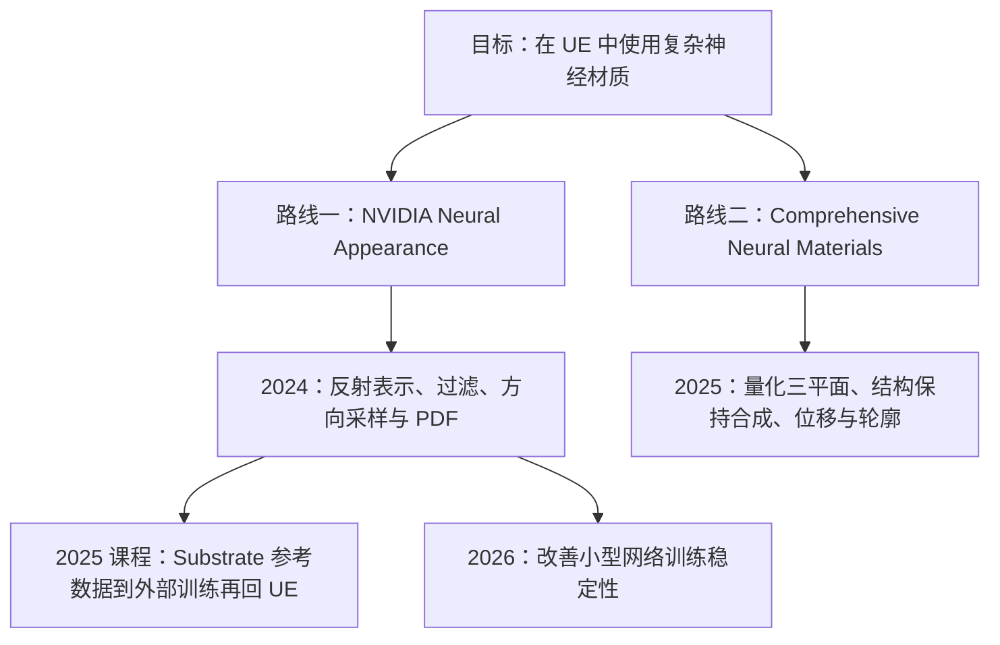

更新：2026-11-01。本文回答：神经技术在游戏引擎各模块中是什么样子、本项目在哪里、神经材质该怎么研究。第 1 节是全景，第 2 节起是图形方向的专题：材质与光照的边界、神经外观的组成、两条研究路线和阅读顺序。这是一篇调研，较新的条目以厂商官方资料为准。

## 1. 全景地图

本项目的思路是：**保留传统引擎的模块分工，把其中某一块换成神经网络**。「落地程度」指在商业游戏和引擎中的成熟度。

### 1.1 渲染

| 环节 | 神经化的做法 | 代表工作 / 现状 | 落地程度 | 本项目 |
|---|---|---|---|---|
| 几何 | 神经 SDF、神经位移、神经 LOD | 以研究为主 | 低 | — |
| 纹理 | NTC（神经纹理压缩） | NVIDIA RTX Neural Texture Compression SDK，需自行集成 | 低 | — |
| **材质** | 神经 BSDF / 神经外观 | **UE 中没有现成集成** | 低 | **当前主线** |
| 角色渲染 | 针对人脸的神经增强 | NVIDIA RTX Neural Faces 一类，较新 | 低 | — |
| 光照 | 神经辐射缓存（NRC）、神经 GI | NVIDIA RTXGI SDK 含 NRC | 低到中 | — |
| 重建 / 后处理 | ML 超分、帧生成、神经降噪 | DLSS、FSR 4、XeSS、PSSR | **高**：各硬件平台的标配 | — |
| 通用神经 shader | 用小网络拟合任意 shader 函数 | RTX Neural Shaders / RTXNS | 低：较新 | — |

神经材质在 UE 中恰好是「研究基础充分、但没有现成集成」的一块，这也是本项目的价值所在。

### 1.2 其他模块

- **动画**：从离线模拟学变形（UE 的 ML Deformer，已进引擎）、学习式动作匹配、语音驱动面部动画（Audio2Face）、视频动捕（MetaHuman Animator）。
- **物理**：网络直接替代求解器，泛化和长时间稳定性难保证，所以游戏中更常见的是「网络辅助、传统求解器兜底」：加速最贵的一步、补细节，或用强化学习训练物理角色控制器（Learning Agents）。渲染的误差只影响当前画面，物理的误差会随时间累积。
- **AI、音频、内容生产、测试、运营**：对话 NPC 与强化学习 bot、语音合成、纹理与材质生成、自动化测试与视觉 bug 检测、反作弊、推荐与难度调整。离线工具门槛最低，普及最快。

### 1.3 公共底座

所有模块在运行时做的是同一件事：在帧预算内运行小网络。可迁移的基础设施有：推理运行时（权重放在哪、怎样打包、fp16 / INT8、寄存器与占用率）、硬件加速（tensor core、cooperative vector）、引擎框架（UE 的 NNE 面向 CPU 与独立 GPU 推理，本项目把权重直接放进 shader，是另一种做法）、训练与数据管线。本项目在这几项上的积累见 [性能报告](/projects/neural-bsdf-perf/performance/) 和 [捕获与对比](/projects/neural-bsdf-perf/capture-and-comparison/)。

### 1.4 暂不考虑的路线

- **辐射场（NeRF、3D 高斯）**：从多视角照片直接学最终画面，光照被烘焙进表示，难以重光照、换材质和交互，适合重建、XR、数字孪生。
- **生成式 / 世界模型**：几乎抛开传统管线，离可控的实时游戏渲染还远。

## 2. 材质与光照的边界

神经外观负责「表面怎样反射光」，不负责「光在场景中怎样传播」：阴影、GI、Lumen、反射、降噪仍由引擎完成。许多光照算法默认材质是解析 BRDF（如 GGX），神经材质要逐一提供替代：

| 光照算法 | 需要材质提供 | 神经材质的处理 |
|---|---|---|
| 点光、方向光（直接光） | `eval(ωi, ωo)` | 已实现（延迟光照） |
| 路径追踪、光追反射 | `sample` 与 `pdf` | 采样网络（NVIDIA 2024），或解析近似的 pdf |
| 环境光 / IBL | 半球预积分的响应 | 给网络加环境光输出头，或拟合等效的 roughness 与 F0 |
| Lumen GI、反射 | Lumen 只读取简化参数，不调用完整 BRDF | 逐 texel 的代理参数（M4） |
| 面光源（LTC 等） | 针对 GGX 拟合的 LTC 系数 | 代理参数或专门的输出 |
| 次表面、透射、多层 | Substrate 按 closure 分别处理 | 目前只作为不透明反射 |

用神经网络来做光照本身（NRC、神经降噪、神经 GI）与神经材质相互独立，可以叠加。

## 3. 神经外观的组成与本项目覆盖

| 环节 | 本项目现状 |
|---|---|
| 训练 / 蒸馏 | 已有：引擎内捕获 Substrate 渲染结果训练，同路径误差 11.8% |
| 存储 | 部分：权重在常量缓冲，潜纹理未压缩（NTC 可补） |
| 查询与过滤（LOD） | 缺：论文把 mip 层级作为网络输入训练，或用随机过滤 |
| 求值 | 已有：fp16 / dp4a 核，接入 Substrate 延迟光照 |
| 采样 | 缺 |
| 直接光 | 已有 |
| 间接光 | 已有：逐 texel 代理（M4），清漆的锐利反射仍弱 |
| 运行时工程 | 与 Substrate 解耦已完成（M2），tensor core 受限于 SDK（M5） |

## 4. 术语对齐

| 表示 | 核心自变量 | 网络主要预测什么 |
|---|---|---|
| 神经纹理 | 纹理坐标、mip / LOD | 纹理通道值，或恢复这些值的特征 |
| 神经材质 / Neural BSDF | 入射和出射方向，通常还条件于潜纹理 | BRDF / BSDF 值，以及采样方向与 pdf |
| 神经外观 | 系统概念：空间潜变量、神经材质、采样、LOD 与渲染器实现 | 以紧凑表示保留空间变化的高频、分层外观 |
| 神经 shader | 程序定义的 shader 输入 | 目标 shader 函数或可学习的计算 |

三者都叫「神经」，接口和误差类型完全不同：NTC 从 UV / mip 解出 base color 等，再交给传统材质函数；神经外观取潜纹理、用方向求 `f(ωi,ωo)` 并生成采样方向；GratNet 学的是受限条件下衍射表面的角度响应。

## 5. 神经材质的两条研究路线

两条路线是独立实现，资产格式、权重布局、方向约定和推理代码都不能直接混用。本项目的 latent 模型（10→32→32→3）沿用路线一的思路，QTP 模型（12→32→32→32→3 INT8）沿用路线二的三平面量化表示。

**路线一**：2024 论文给出潜纹理、学习的 shading frame、BRDF 求值、采样器、LOD 与内联推理；2025 课程补充 Substrate 到 UE 的工程实践；2026 Taming 论文改善小网络训练稳定性。研究库从 MaterialX / MDL 生成训练样本；课程讲的由 Substrate 生成参考数据的路径，正是本项目引擎内捕获采用的思路。

**路线二**：空间 U 平面与方向 H / D 平面提供特征，量化 MLP 重建反射；ACF 引导的合成把小块材质扩展到大表面；高度场追踪提供视差与轮廓（轮廓来自求交模块，不是反射网络产生的几何）。边界：正文没有解决专用重要性采样，不能默认获得与路线一等价的 eval / sample / pdf 接口；训练需要 BTF 或相应的合成反射数据。

按问题选资料：

| 当前问题 | 资料 |
|---|---|
| 在 UE 中运行神经材质，理解 BSDF 与采样接口 | NVIDIA 2024 + 2025 UE 课程 |
| 小网络训练质量受初始化影响 | NVIDIA 2026 Taming |
| 小样本扩展、结构保持、量化推理 | Comprehensive 2025 |
| 保留潜空间的分层组合能力 | Neural Layered BRDFs（2022） |
| 通用的分布学习式采样 | PureSample（2026） |
| 贴图显存 | NTC（2023） |
| 衍射等波动光学外观 | GratNet（2025） |

各篇解析见 [论文笔记总览](/projects/neural-bsdf-perf/papers/)。

## 6. 阅读顺序

1. **NVIDIA 2024**：建立完整的神经外观概念（潜纹理、求值、采样、LOD）。
2. **2025 课程**：Substrate 到 UE 的实际工程经验，包括 Lumen 适配。
3. **Comprehensive 2025**：量化三平面（本项目 QTP 模型的来源）、合成与位移。
4. **NVIDIA 2026 Taming**：训练稳定性。
5. 按下一步的目标延伸：间接光看课程的 Lumen 部分，存储看 NTC，采样看 NVIDIA 2024 的采样器与 PureSample，衍射看 GratNet。
