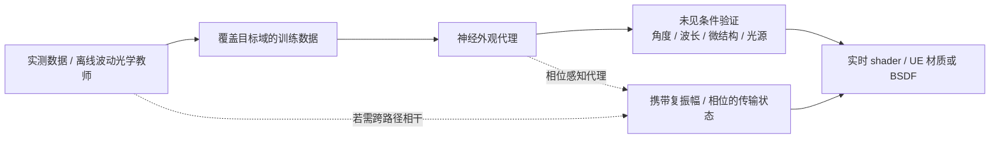

# 神经外观与波动光学

更新：2026-10-22（初稿 2026-10-17）。本文回答：衍射、干涉、薄膜、结构色这类波动光学外观，能否用神经外观做实时代理，边界在哪里；以及本地 NvRTX / Zorah 工程和这件事的关系。波动光学在 [路线图](/projects/neural-bsdf-perf/roadmap/) 中是运行时成熟后的可选展示项，不是主线。

## 1. 结论

- **波动光学可以当教师，神经外观可以当实时代理**：用离线波动光学求解器或实测数据生成参考，训练神经模型近似「微结构参数、波长、入射与观察方向 → 光谱反射或衍射响应」，推理时替代昂贵的参考计算。GratNet 已在受限的衍射表面上直接展示了这条路线。
- **边界是相位**：如果目标只是某类表面的局部有效反射或衍射响应，普通神经 BSDF 就能近似；如果相干路径还要跨表面传播并继续干涉，只输出 RGB 能量的网络无法恢复已丢失的相位，渲染器必须携带复振幅或相位等状态。
- **网络不会补出教师没有的物理**：适用范围取决于训练数据覆盖的视角、光照、波长、偏振、几何和材质参数。
- **准确的表述**是「对目标域进行物理教师驱动的神经代理化」，而不是「神经网络自动替换任意波动光学 shader」。

## 2. 波动光学在问题分层中的位置

| 问题层 | 典型瓶颈 | 传统做法 | 神经方向 | 边界 |
|---|---|---|---|---|
| 局部复杂光学响应 | 薄膜干涉、衍射、结构色、微结构造成的方向与波长相关反射 | 波动光学 BSDF、离线求解器；Substrate 有薄膜干涉等特定材质 | 以物理求解器或测量数据为教师训练神经 shader，例如 GratNet | 拟合的是局部反射函数；不能推断所有材质和条件都能泛化 |
| 全局光学传输 | 波场跨表面传播、多条相干路径干涉、偏振与相位变化 | 波动光学路径 / 波场传播方法，例如 Wave Tracing | 相位感知的神经代理，或学习加速求解步骤 | 渲染器需要携带复振幅 / 相位；普通神经材质不够 |

其他层（几何、纹理、材质、间接光、图像重建）的神经化方向见 [全景与研究路线](/projects/neural-bsdf-perf/research/) 第 1 节。

## 3. 组合路线

1. **固定目标范围**：先选一种现象和场景条件，例如某类周期微结构的结构色；明确要泛化哪些微结构参数、波长、入射与观察角、偏振和光源条件。
2. **建立物理教师**：用离线求解器或实测结果生成覆盖这些条件的参考数据。拟合有效强度响应时保存光谱与角度反射；需要跨路径相干时还要保存相位或复振幅及传播所需的信息。
3. **训练并压缩代理**：检查推理开销、内存、误差、能量守恒与互易性，留出未见参数测试。不要只训练固定视角、固定灯光的图像，否则学到的只是那一种布光下的外观。
4. **接入实时渲染器**：先在独立 shader 或小型渲染器中验证，再接 UE 材质或 BSDF。只有相干效应需要跨表面传播时，才需要改造渲染器的路径状态；局部响应代理不要求重写引擎。

本项目已有的 BSDF 契约（[系统架构](/projects/neural-bsdf-perf/architecture/) 第 4 节）正好对应第 4 步的「局部响应代理」。

## 4. 测试场景

波动光学应先用能对照物理求解器的标准实验，算法通过后再进入 UE 场景。

| 场景 | 测试对象 | 获取与注意事项 |
|---|---|---|
| 双缝 / Cornell box（Wave Tracer 自带场景） | 衍射、干涉条纹；神经代理相对物理教师的误差 | [Wave Tracer 仓库](https://github.com/ssteinberg/wave_tracer)：`scenes/diffraction_simple/double_slits.xml`、`scenes/cornell-box/box.xml`、`scenes/bidir_room/room.xml`。CPU、早期 alpha，计算量约为普通光线追踪的 5–20 倍；许可证 CC BY-NC 4.0，使用前确认用途 |

建议的顺序：先复现双缝条纹或单个衍射表面的角度 / 波长响应，以 Wave Tracer 或目标离线 shader 为参考；训练代理后用未见的缝宽、微结构、波长和入射角测试；通过后再放进 Cornell box 或 UE 的小型受控场景。材质与 UE 场景用的通用测试资源见 [Demo 计划与资源](/projects/neural-bsdf-perf/demos/)。

## 5. 可核验的波动光学渲染工作

| 工作 | 内容 | 性质 |
|---|---|---|
| GratNet（arXiv 2025） | MLP 学习衍射表面的反射数据，与离线波动光学前向模型比较，主观质量相近、性能显著提升，原始数据内存约压缩两个数量级 | 神经代理；结论限于论文覆盖的衍射表面与数据分布（[解析](/projects/neural-bsdf-perf/papers/gratnet/)） |
| A Free-Space Diffraction BSDF（SIGGRAPH 2024） | 路径追踪中基于几何边缘的 Fraunhofer 衍射 BSDF | 专门的波动光学材质 / 传输模型，不是神经材质 |
| A Wave-optics BSDF for Correlated Scatterers（EGSR 2025） | 布料孔隙、玻璃凝露等相关无序散射体造成的 corona 干涉 | 波动光学 BSDF |
| Wave Tracing（2025） | 把路径积分推广到波动光学，分析并模拟路径间干涉 | 渲染理论与求解方法 |
| HoloPathTracer（SIGGRAPH 2026） | 结合路径追踪与波场传播，面向全息显示 | 不是 UE 常规渲染器的插件 |
| Chromatix（Nature Methods 2026） | 可微 GPU 波动光学仿真库，面向计算光学、显微成像、全息与逆问题 | 光学仿真工具 |

## 6. NvRTX、Zorah 与 RTXNS 是什么

- **RTXNS**：NVIDIA 的神经 shader SDK 与示例，展示在 Slang 中训练或推理小型网络；不是 NvRTX 中自动启用的神经外观系统（本地 `RTXNS`，见 [本地研究代码导读](/projects/neural-bsdf-perf/code-guide/) 2.5 节）。
- **NvRTX-5.8**：NVIDIA 修改的 UE 源码分支，提供 DLSS、NRD、NIS、RTX 路径追踪等能力。神经上采样或降噪不等于神经材质。
- **Zorah**：基于较早 NvRTX 分支的场景与路径追踪样例。本地 README 把重点列为 RTX Mega Geometry、RTXDI、ReSTIR GI / PT 和 DLSS；工程启用了 DLSS / Streamline 插件；已检查的资产中没有找到 NTC、神经材质或 NRC。快速入门里的「neural graphics technologies」是概括性描述，不能证明集成了神经外观。

核对过的本地文件：`本地的 Zorah 样例工程\README.md`、`Zorah.uproject`、`ZORAH_QUICKSTART.md`。

| 目标 | 更直接的起点 | 是否需要 Zorah / NvRTX |
|---|---|---|
| 学习、训练分层神经材质 | `neuralappearance` 与 MaterialX Teapot / Lion | 否 |
| 编写自定义 Slang 神经 shader | RTXNS 示例 | 否，之后需自行接入 UE |
| 研究衍射、干涉、全息 | Wave Tracing、波动 BSDF、Chromatix | 否 |
| 把离线复杂材质神经化并移植到 UE | `neuralappearance` 作训练参考；SIGGRAPH 2025 课程记录了把多层 Substrate 材质烘焙成神经材质并接入 UE 光栅化的案例（目标 4K / 60 FPS，材质内存约为参考的五分之一） | 否；那是特定演示的结果，不保证其他场景 |
| 测试 Mega Geometry、ReSTIR、DLSS 等 NvRTX 特性 | Zorah 与 NvRTX 引擎 | 是 |

更省风险的流程是先在专用代码或离线渲染器中验证表示、训练数据与误差，再决定是否移植到 UE，避免把「算法能否表达目标现象」与「引擎资产管线是否接通」混成一个问题。

## 7. 参考资料

- Kandel and Dhillon, [GratNet: A Photorealistic Neural Shader for Diffractive Surfaces](https://arxiv.org/abs/2506.15815)
- Steinberg et al., [A Free-Space Diffraction BSDF, SIGGRAPH 2024](https://research.nvidia.com/labs/rtr/publication/steinberg2024diffraction/)
- Yang et al., [A Wave-optics BSDF for Correlated Scatterers, EGSR 2025](https://doi.org/10.1111/cgf.70167)
- Steinberg and Pharr, [Wave Tracing: Generalizing the Path Integral to Wave Optics](https://arxiv.org/abs/2508.17386)
- Zhou et al., [HoloPathTracer, SIGGRAPH 2026](https://zhou-wb.github.io/holopathtracer/)
- Deb et al., [Chromatix, Nature Methods 2026](https://www.nature.com/articles/s41592-026-03121-x)
- Steinberg et al., [Wave Tracer source code and sample scenes](https://github.com/ssteinberg/wave_tracer)
- Andrea Weidlich, [Bridging the Gap between Offline and Real Time with Neural Materials, SIGGRAPH 2025 course](https://blog.selfshadow.com/publications/s2025-shading-course/)
- NVIDIA, [RTX Neural Shading SDK (RTXNS)](https://github.com/NVIDIA-RTX/RTXNS)
